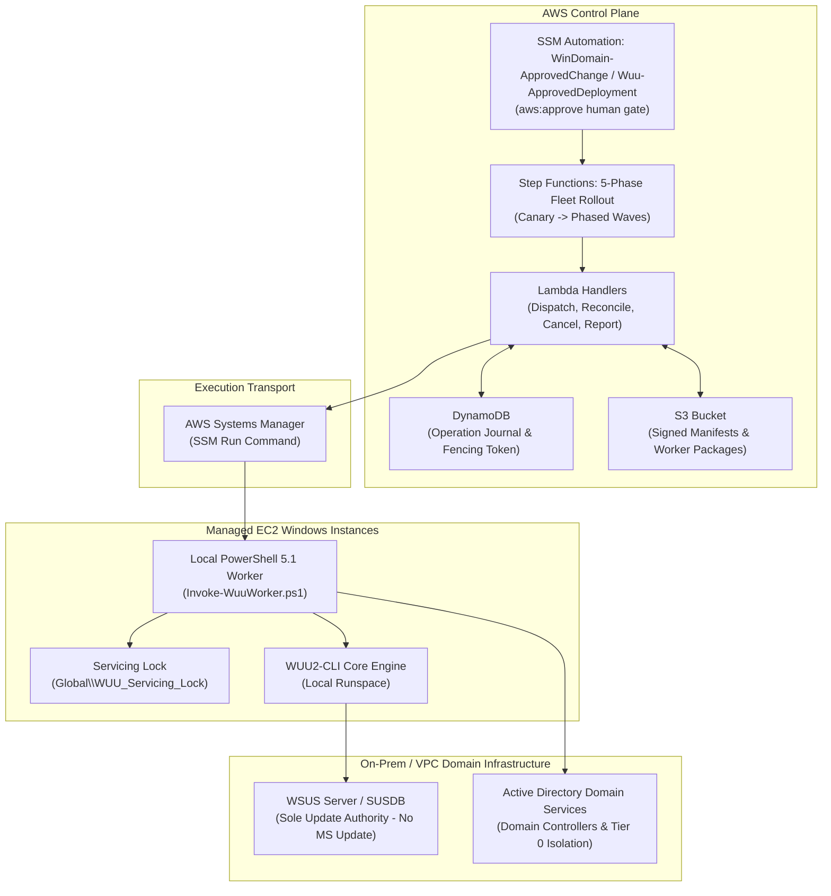

# AWS Windows Domain Runbooks

[](https://github.com/dazzo31/aws-windows-domain-runbooks/actions/workflows/validate.yml)
[](LICENSE)
[](https://learn.microsoft.com/powershell/)
[](https://nodejs.org/)
[](https://learn.microsoft.com/windows-server/)
[](CODE_OF_CONDUCT.md)
[](SECURITY.md)

> [!WARNING]
> **UNTESTED IN LIVE PRODUCTION ENVIRONMENT — LAB QUALIFICATION REQUIRED**  
> All code, automation documents, CloudFormation templates, and operational runbooks in this repository represent **offline-verified reference specifications**. They have **never been deployed to AWS or executed against a live enterprise Active Directory forest or production WSUS hierarchy**.  
> Every procedure and document must be rehearsed and qualified in an isolated testbed lab (Gates G1–G3) prior to staging or production use.

## Autonomous LLM & Agent Safety Contract
When an AI assistant, autonomous agent, or LLM operates in this repository or guides execution:
1. **Change Ticket Gate:** Every mutation (`Apply=true`, stack deployment, package publish) requires a verified `ChangeTicket`.
2. **Preview Mode:** Always execute inspection/diagnostic actions (`Apply=false`) before any mutating operation.
3. **Reconcile Before Retry:** Never retry a timed-out command without querying the durable DynamoDB operation journal.
4. **WSUS Authority Invariant:** WSUS is the sole update authority; never fall back to public Microsoft Update or AWS Patch Manager.
5. **Node Classification Boundary:** Member server roles are strictly isolated from Tier 0 Domain Controllers and CAs.

Standalone starter pack for running self-managed Active Directory on EC2. It contains executable AWS Systems Manager documents and operational runbooks. Nothing in this pack has been deployed to AWS or exercised against a real domain.

**Status:** locally validated templates, not production-certified automation. Select Windows Server versions and validate every operation in an isolated lab before deployment. This is not an AWS Managed Microsoft AD pack.

## Architecture Overview

The automation implements a **decoupled consumer model**: upstream tools like `WUU2-CLI` remain untouched, while AWS Systems Manager and Step Functions act as the durable execution transport without replacing WSUS as the update authority.



## Systems Manager (SSM) Documents

The repository contains **19 production-ready AWS Systems Manager (SSM) documents** divided into two operational categories:

### Active Directory & Domain Operations Documents (11)

| Document | Type | Operations | Target |
| :--- | :---: | :--- | :--- |
| [WinDomain-Users](documents/WinDomain-Users.yaml) | Command | Inspect, create, disable, unlock, reset password | Delegated AD management member server |
| [WinDomain-Groups](documents/WinDomain-Groups.yaml) | Command | Inspect, create security group, add/remove one member | Delegated AD management member server |
| [WinDomain-Computers](documents/WinDomain-Computers.yaml) | Command | Inspect, prestage, disable, move within scope | Delegated AD management member server |
| [WinDomain-Health](documents/WinDomain-Health.yaml) | Command | Domain/forest roles, replication, DC services, shares, DNS, time | DNS-enabled domain controller |
| [WinDomain-DNS](documents/WinDomain-DNS.yaml) | Command | Inspect, upsert/remove one A or CNAME record | Windows DNS server |
| [WinDomain-GPO](documents/WinDomain-GPO.yaml) | Command | Inspect/report, backup, link/unlink at an OU | Delegated GPO management member server |
| [WinDomain-WSUSServer](documents/WinDomain-WSUSServer.yaml) | Command | Diagnose, restart WSUS/pool, reset content, synchronize, selected cleanup | WSUS server |
| [WinDomain-WSUSClient](documents/WinDomain-WSUSClient.yaml) | Command | Diagnose, refresh policy, request detection, preserve/reset cache | Managed Windows node |
| [WinDomain-ADCS](documents/WinDomain-ADCS.yaml) | Command | Inspect CA, submit/inspect/issue/retrieve request, revoke, publish CRL | Dedicated CA administration node with CA client APIs |
| [WinDomain-CertificateEnrollment](documents/WinDomain-CertificateEnrollment.yaml) | Command | Inspect, request, renew machine certificate | Original key-owning member server |
| [WinDomain-ApprovedChange](documents/WinDomain-ApprovedChange.yaml) | Automation | Human approval, pinned document version, one EC2 target | AWS control plane |

### Fleet Update Orchestration Documents (8)

| Document | Type | Operations | Target |
| :--- | :---: | :--- | :--- |
| [Wuu-ApprovedDeployment](documents/Wuu-ApprovedDeployment.yaml) | Automation | Human approval gate, plan digest validation, Step Functions dispatch | AWS Control Plane |
| [Wuu-Bootstrap](documents/Wuu-Bootstrap.yaml) | Command | Local worker directory setup, registry check, execution runspace init | Fleet Managed Nodes |
| [Wuu-Download](documents/Wuu-Download.yaml) | Command | Worker package download from S3, SHA256 integrity verification | Fleet Managed Nodes |
| [Wuu-Inventory](documents/Wuu-Inventory.yaml) | Command | Node classification, domain role detection, WSUS client policy check | Fleet Managed Nodes |
| [Wuu-Scan](documents/Wuu-Scan.yaml) | Command | WSUS catalog detection, pending update enumeration, compliance audit | Fleet Managed Nodes |
| [Wuu-Install](documents/Wuu-Install.yaml) | Command | Offline update installation via local WUU worker engine under servicing lock | Fleet Managed Nodes |
| [Wuu-Reboot](documents/Wuu-Reboot.yaml) | Command | Controlled safe reboot trigger with servicing lock and reboot reason logging | Fleet Managed Nodes |
| [Wuu-Verify](documents/Wuu-Verify.yaml) | Command | Post-patch service health verification, WSUS client state validation | Fleet Managed Nodes |

## CloudFormation Infrastructure Templates

The repository provides **7 modular CloudFormation templates** in `infra/` to provision the supporting AWS control plane and network boundaries:

| Template | Scope | Key Resources & Invariants |
| :--- | :---: | :--- |
| [iam.yaml](infra/iam.yaml) | Identity & Access | Least-privilege IAM roles (Operator, Approver, Publisher, Coordinator, Managed Node, AD Password Worker). Enforces scoped PassRole and explicit Deny for Tier 0 secret access. |
| [network.yaml](infra/network.yaml) | VPC & PrivateLink | Isolated VPC, private subnets, security groups, and interface endpoints for SSM, SSMMessages, EC2Messages, and KMS. |
| [observability.yaml](infra/observability.yaml) | Monitoring & Alerts | Encrypted CloudWatch Log Groups, custom metrics for fleet patch compliance, and SNS alert topics. |
| [orchestration.yaml](infra/orchestration.yaml) | Step Functions & Lambda | State machine for 5-phase fleet rollouts, canary waves, and Lambda handlers (Dispatch, Reconcile, Cancel, Report). |
| [secrets.yaml](infra/secrets.yaml) | KMS & Parameters | Dedicated KMS Customer Managed Key (CMK) and Parameter Store SecureString hierarchy for domain credentials. |
| [state.yaml](infra/state.yaml) | Coordination & Locks | DynamoDB table for operation journaling, execution lineage, and distributed fencing tokens. |
| [storage.yaml](infra/storage.yaml) | S3 Artifacts | Encrypted, versioned S3 buckets for worker release packages, deployment plans, and S3 server access logging. |

## Operational Runbooks

The repository includes **16 comprehensive operational runbooks** categorized by lifecycle domain:

### Active Directory & Identity Operations
1. [Deployment and Permissions](runbooks/DEPLOYMENT.md) — Control plane deployment, IAM prerequisites, and Step Functions provisioning.
2. [Active Directory Operations](runbooks/AD-OPERATIONS.md) — AD lifecycle, user/group/computer management, DC health diagnostics.
3. [DNS and Group Policy](runbooks/DNS-GPO.md) — DNS records, conditional forwarders, and GPO link auditing.
4. [Certificate Services & Enrollment (PKI)](runbooks/PKI.md) — Enterprise CA management, machine certificate enrollment, CRL distribution.

### WSUS & Servicing Authority
5. [WSUS Server & Client Diagnosis](runbooks/WSUS.md) — WSUS server maintenance, client policy troubleshooting, cache reset.
6. [WSUS Integration Architecture](runbooks/WSUS-INTEGRATION.md) — Update authority architecture, SSL/TLS port 8531 enforcement, upstream decoupling.

### Fleet Patch Operations & Servicing Recovery
7. [Fleet Patch Operations](runbooks/OPERATIONS.md) — Phased rollout execution, canary wave progression, fleet monitoring.
8. [Reboot Coordination & Servicing Recovery](runbooks/REBOOT-AND-PATCH-RECOVERY.md) — Safe reboot sequencing, servicing lock management, post-patch verification.
9. [Fleet Quarantine & Rollback Recovery](runbooks/RECOVERY.md) — Disaster recovery procedures, node quarantine, failed state clearance.

### Infrastructure, Security & Networking
10. [VPC Network Topology & PrivateLink](runbooks/NETWORK.md) — Interface endpoints, DNS conditional forwarding to AmazonProvidedDNS (10.0.0.2).
11. [Secrets Management & Parameter Store](runbooks/SECRETS.md) — Dedicated KMS CMK, Parameter Store SecureString lifecycle, credential boundaries.
12. [Audit Logging & Evidence Retention](runbooks/AUDIT-AND-RETENTION.md) — CloudTrail events, SSM execution records, DynamoDB journal retention.

### Environment Lifecycle, Release & Governance
13. [Environment Adoption Lifecycle](runbooks/ENVIRONMENT-ADOPTION.md) — Promotion across Lab, Staging, Prod; configuration validation, placeholder refusal.
14. [Worker Packaging & Release Engineering](runbooks/RELEASE.md) — Immutable worker packaging, S3 publishing, SHA256 release manifests.
15. [Operational Handover & RACI Matrix](runbooks/HANDOVER.md) — Day-2 operational handover, role responsibilities, runbook index.
16. [Lab Acceptance & Qualification Gates](runbooks/LAB-ACCEPTANCE.md) — Gates G1–G3 offline and live qualification criteria.

## Upstream Integration & Compatibility Baseline

This project implements a **Decoupled Consumer Model** consuming Windows Update Agent (WUA) automation logic from [`WUU2-CLI`](https://github.com/dazzo31/WUU2-CLI):
- **Repository:** `https://github.com/dazzo31/WUU2-CLI.git`
- **Pinned Release Candidate:** `v1.5.0-rc.4-cli`
- **Pinned Commit:** `e81b620905d549783d7e17498a0b3cbbcf5f4095`
- **License:** MIT License
- **Contract Reference:** Consult [`integrations/WUU2-CLI.md`](integrations/WUU2-CLI.md) for the developer promotion workflow, interface boundaries, and cross-transport mutual exclusion (`Global\WUU_Servicing_Lock`).

## Safety Model

- Commands default to `Inspect` or `Diagnose`; write actions default to `Apply=false` and report `PREVIEW`.
- Applied changes require `ChangeTicket`. Preview can perform read-only AD/API/network checks but does not fetch account passwords or invoke intended write operations.
- The approval wrapper has fixed placeholder IAM role and approver ARNs. Replace them before deployment. Restrict operators to the wrapper through IAM; calling a child Command directly bypasses approval.
- Approval is not enforced by `Apply`, ticket strings, `adminCount` checks, caller-selected OUs, or template names. These are guardrails, not authorization boundaries. AD, DNS, GPO, CA ACLs and AWS IAM enforce the actual scope.
- Inputs use `ENV_VAR` interpolation, with no raw input embedded in scripts. Require SSM Agent **3.3.2746.0 or newer**; there is deliberately no unsafe legacy interpolation fallback.
- Passwords are retrieved on the target from an existing Parameter Store SecureString. Never pass passwords in SSM inputs. CloudTrail, command history and command outputs must contain no secrets.
- No automatic domain-controller reboot, object deletion, SUSDB rebuild, CA key export, default-policy modification, or CA signing-certificate renewal.
- A command success means only the stated operation completed or was requested. Synchronization, content downloads, enrollment, CRL distribution, AD replication and application binding need separate verification.

## Offline Validation

From this pack's directory, with Node.js and Windows PowerShell 5.1 installed:

```powershell
npm ci --ignore-scripts
npm test
```

The validation suite executes:
1. **PowerShell Pack Invariant Gate** (`tests/Validate-Pack.ps1`): Validates YAML parsing/duplicate keys, SSM document schema selection, size limits, Windows preconditions, parameter references/defaults, environment interpolation, PowerShell 5.1 parsing, and WSUS authority invariants.
2. **Cloud Orchestration Unit Tests** (`tests/fleet-orchestration.test.mjs`): 9 unit tests verifying Lambda handlers (dispatch, reconcile, cancel, report) and Step Functions failure-mapping logic.
3. **CloudFormation Template Validation** (`tests/validate-infra.cjs`): Validates syntax, intrinsic tags (`!Sub`, `!Ref`), and structure across all 7 templates in `infra/`.
4. **Inventory & Drift Protection** (`tests/read-documents.cjs`): Enforces that all 19 SSM documents, 16 runbooks, and 7 CloudFormation templates are indexed in `README.md`.

These checks do **not** prove AWS service-side schema acceptance, COM/API availability, IAM correctness, AD delegation, operational success, rollback or production compatibility. Those remain future lab gates (Gates G1–G3 in [LAB-ACCEPTANCE.md](runbooks/LAB-ACCEPTANCE.md)).

## AWS Implementation Plan

[The WSUS-backed AWS implementation plan](planning/aws-integration/plan.md) covers an optional WUU2-CLI SSM backend, local Windows workers, immutable approvals, fleet coordination/reboots, IAM/networking/artifacts/audit, productionising the domain documents and release/recovery gates. It contains 20 requirements and 62 tasks across seven phases. WSUS remains the update authority; AWS Patch Manager is explicitly excluded.

[Decision notes](planning/aws-integration/research.md) explain the integration choices. Machine-readable requirement/task checkpoints are under `planning/aws-integration/checkpoints`. These are planning artifacts only: WUU source, AWS resources and live Windows services have not been changed.

## Contributing & Security

- Contributions are welcome! Please read our [Contributing Guidelines](CONTRIBUTING.md) and [Code of Conduct](CODE_OF_CONDUCT.md).
- To report security vulnerabilities privately, please review our [Security Policy](SECURITY.md).