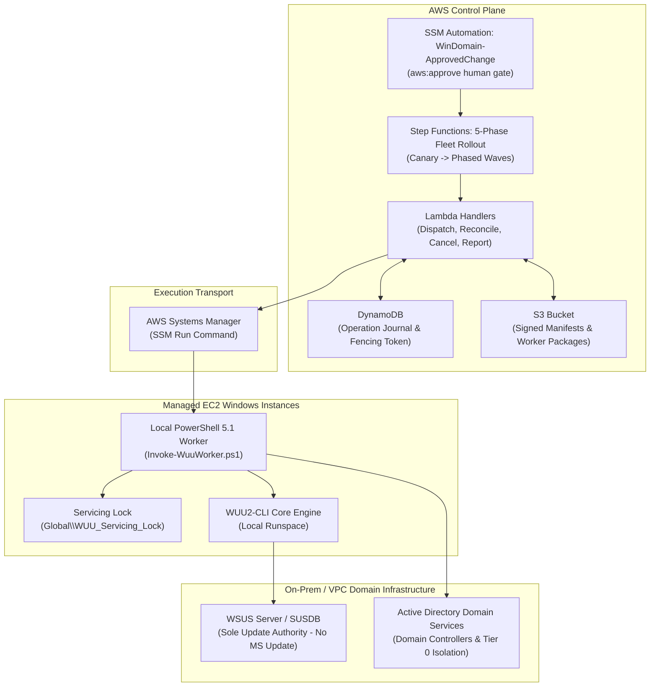

# AWS Windows Domain Runbooks

[](https://github.com/dazzo31/aws-windows-domain-runbooks/actions/workflows/validate.yml)
[](LICENSE)
[](https://learn.microsoft.com/powershell/)
[](https://nodejs.org/)
[](https://learn.microsoft.com/windows-server/)

> [!WARNING]
> **UNTESTED IN LIVE PRODUCTION ENVIRONMENT — LAB QUALIFICATION REQUIRED**  
> All code, automation documents, CloudFormation templates, and operational runbooks in this repository represent **offline-verified reference specifications**. They have **never been deployed to AWS or executed against a live enterprise Active Directory forest or production WSUS hierarchy**.  
> Every procedure and document must be rehearsed and qualified in an isolated testbed lab (Gates G1–G3) prior to staging or production use.

## Autonomous LLM & Agent Safety Contract
When an AI assistant, autonomous agent, or LLM operates in this repository or guides execution:
1. **Change Ticket Gate:** Every mutation (`Apply=true`, stack deployment, package publish) requires a verified `ChangeTicket`.
2. **Preview Mode:** Always execute inspection/diagnostic actions (`Apply=false`) before any mutating operation.
3. **Reconcile Before Retry:** Never retry a timed-out command without querying the durable DynamoDB operation journal.
4. **WSUS Authority Invariant:** WSUS is the sole update authority; never fall back to public Microsoft Update or AWS Patch Manager.
5. **Node Classification Boundary:** Member server roles are strictly isolated from Tier 0 Domain Controllers and CAs.

Standalone starter pack for a future project running self-managed Active Directory on EC2. It contains executable AWS Systems Manager documents and operational runbooks. Nothing in this pack has been deployed to AWS or exercised against a real domain.

**Status:** locally validated templates, not production-certified automation. Select Windows Server versions and validate every operation in an isolated lab before deployment. This is not an AWS Managed Microsoft AD pack.

## Architecture Overview

The automation implements a **decoupled consumer model**: upstream tools like `WUU2-CLI` remain untouched, while AWS Systems Manager and Step Functions act as the durable execution transport without replacing WSUS as the update authority.



## Documents

| Document | Type | Operations | Target |
| --- | --- | --- | --- |
| [WinDomain-Users](documents/WinDomain-Users.yaml) | Command | Inspect, create, disable, unlock, reset password | Delegated AD management member server |
| [WinDomain-Groups](documents/WinDomain-Groups.yaml) | Command | Inspect, create security group, add/remove one member | Delegated AD management member server |
| [WinDomain-Computers](documents/WinDomain-Computers.yaml) | Command | Inspect, prestage, disable, move within scope | Delegated AD management member server |
| [WinDomain-Health](documents/WinDomain-Health.yaml) | Command | Domain/forest roles, replication, DC services, shares, DNS, time | DNS-enabled domain controller |
| [WinDomain-DNS](documents/WinDomain-DNS.yaml) | Command | Inspect, upsert/remove one A or CNAME record | Windows DNS server |
| [WinDomain-GPO](documents/WinDomain-GPO.yaml) | Command | Inspect/report, backup, link/unlink at an OU | Delegated GPO management member server |
| [WinDomain-WSUSServer](documents/WinDomain-WSUSServer.yaml) | Command | Diagnose, restart WSUS/pool, reset content, synchronize, selected cleanup | WSUS server |
| [WinDomain-WSUSClient](documents/WinDomain-WSUSClient.yaml) | Command | Diagnose, refresh policy, request detection, preserve/reset cache | Managed Windows node |
| [WinDomain-ADCS](documents/WinDomain-ADCS.yaml) | Command | Inspect CA, submit/inspect/issue/retrieve request, revoke, publish CRL | Dedicated CA administration node with CA client APIs |
| [WinDomain-CertificateEnrollment](documents/WinDomain-CertificateEnrollment.yaml) | Command | Inspect, request, renew machine certificate | Original key-owning member server |
| [WinDomain-ApprovedChange](documents/WinDomain-ApprovedChange.yaml) | Automation | Human approval, pinned document version, one EC2 target | AWS control plane |

## Safety Model

- Commands default to `Inspect` or `Diagnose`; write actions default to `Apply=false` and report `PREVIEW`.
- Applied changes require `ChangeTicket`. Preview can perform read-only AD/API/network checks but does not fetch account passwords or invoke intended write operations.
- The approval wrapper has fixed placeholder IAM role and approver ARNs. Replace them before deployment. Restrict operators to the wrapper through IAM; calling a child Command directly bypasses approval.
- Approval is not enforced by `Apply`, ticket strings, `adminCount` checks, caller-selected OUs, or template names. These are guardrails, not authorization boundaries. AD, DNS, GPO, CA ACLs and AWS IAM enforce the actual scope.
- Inputs use `ENV_VAR` interpolation, with no raw input embedded in scripts. Require SSM Agent **3.3.2746.0 or newer**; there is deliberately no unsafe legacy interpolation fallback.
- Passwords are retrieved on the target from an existing Parameter Store SecureString. Never pass passwords in SSM inputs. CloudTrail, command history and command outputs must contain no secrets.
- No automatic domain-controller reboot, object deletion, SUSDB rebuild, CA key export, default-policy modification, or CA signing-certificate renewal.
- A command success means only the stated operation completed or was requested. Synchronization, content downloads, enrollment, CRL distribution, AD replication and application binding need separate verification.

## Runbooks

1. [Deployment and permissions](runbooks/DEPLOYMENT.md)
2. [AD lifecycle and domain diagnostics](runbooks/AD-OPERATIONS.md)
3. [DNS and Group Policy](runbooks/DNS-GPO.md)
4. [WSUS diagnosis and recovery](runbooks/WSUS.md)
5. [Certificate services and enrollment](runbooks/PKI.md)
6. [Lab acceptance and release gates](runbooks/LAB-ACCEPTANCE.md)

## AWS Implementation Plan

[The WSUS-backed AWS implementation plan](planning/aws-integration/plan.md) covers an optional WUU2-CLI SSM backend, local Windows workers, immutable approvals, fleet coordination/reboots, IAM/networking/artifacts/audit, productionising the domain documents and release/recovery gates. It contains 20 requirements and 62 tasks across seven phases. WSUS remains the update authority; AWS Patch Manager is explicitly excluded.

[Decision notes](planning/aws-integration/research.md) explain the integration choices. Machine-readable requirement/task checkpoints are under planning/aws-integration/checkpoints. These are planning artifacts only: WUU source, AWS resources and live Windows services have not been changed.

## Offline Validation

From this pack's directory, with Node.js and Windows PowerShell 5.1 installed:

```powershell
npm ci --ignore-scripts
npm test
```

The validator checks YAML parsing/duplicate keys, SSM document schema selection, size limits, Windows preconditions, parameter references/defaults, environment interpolation and PowerShell 5.1 parsing. It executes missing-input guard checks in isolated runspaces and mocks AD/AWS calls for user-preview and missing-ticket tests. It never deploys documents or invokes actual domain/service operations.

These checks do **not** prove AWS service-side schema acceptance, COM/API availability, IAM correctness, AD delegation, operational success, rollback or production compatibility. Those remain future lab gates.

## Remaining Scope

This first pack covers the requested starting operations, not every possible domain management/recovery task. Extend it with reviewed, separately tested workflows for domain join/secure-channel repair, OU creation, GPO setting changes/restoration, privileged/nested groups, DNS AAAA/PTR/SRV records, SUSDB SQL maintenance, patch deployment, DFSR recovery, authoritative AD restore, FSMO seizure, forest recovery, CA disaster recovery, HSM integration and application-specific certificate binding. Never make one generic repair command perform these automatically.

No repository initialization, commit, GitHub upload, AWS deployment or local Windows configuration change is performed by generating this pack.