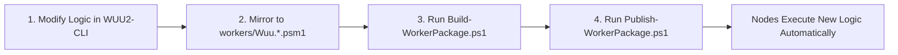

# Upstream Integration Contract: WUU2-CLI

Date: 2026-10-07  
Status: Authoritative Integration Contract (Plan 1.1 / Task T004)  
Scope: Upstream lineage, MIT/NOTICE attribution, Decoupled Consumer Model, and feature compatibility baseline.

---

## 1. Upstream Project Identity & Provenance

This project consumes core Windows Update Agent (WUA) automation logic from [`WUU2-CLI`](https://github.com/dazzo31/WUU2-CLI):

* **Repository:** `https://github.com/dazzo31/WUU2-CLI.git`
* **Pinned Release Candidate:** `v1.5.0-rc.4-cli`
* **Pinned Commit:** `e81b620905d549783d7e17498a0b3cbbcf5f4095`
* **License:** MIT License
* **Verified Verification Baseline:**
  * **59 test suites** (58 PASS / 1 SKIP / 0 FAIL).
  * **1,880 passing assertions** (0 failing).
  * **187 release validation gate checks** (187 PASS, 0 FAIL, 0 WARN, 0 SKIP, 0 NOT_IMPLEMENTED).

### 1.1 Attribution & Provenance Chain
The update automation logic embedded in this repository traces its architectural lineage through four milestones:
1. **2014:** `PoshPAIG` (PowerShell Patch Audit/Installation GUI) by **Boe Prox** (MIT License).
2. **2016:** `Windows Update Utility (WUU)` by **Tyler Siegrist** (Microsoft Script Center / TechNet).
3. **2018:** `WUU2` by **HanSolo71** (MIT License).
4. **2026:** `WUU2-CLI` by **dazzo31** (asynchronous console edition, strict operation identity, audit hash chains, PowerShell 5.1 STA architecture).

All original copyright notices, contributor attributions, and MIT license terms are strictly retained in all packaged artifacts and documentation.

---

## 2. The Decoupled Consumer Model

### 2.1 The Architectural Decision
To prevent contamination of `WUU2-CLI` and avoid the ongoing technical debt of a permanent fork, this project implements a **Decoupled Consumer Model**:

```
+-------------------------------------------------------------+
|                     WUU2-CLI (Upstream)                     |
|  - 100% untouched, independent on-premises repository       |
|  - Zero AWS SDKs, zero cloud dependencies, zero AWS code    |
|  - Retains DCOM remoting, console UI, 59 test suites        |
+-------------------------------------------------------------+
                               |
                               | (Packaged as read-only worker payload)
                               v
+-------------------------------------------------------------+
|             aws-windows-domain-runbooks (This Repo)         |
|  - Standalone cloud deployment client (Invoke-WuuDeployment)|
|  - AWS Systems Manager Automation & Step Functions orchestr. |
|  - Local STA worker wrapper (Invoke-WuuWorker.ps1)          |
|  - Immutable S3 artifacts, DynamoDB locks, CloudWatch logs   |
+-------------------------------------------------------------+
```

### 2.2 Guarantees of the Decoupled Model
1. **Zero Upstream Modifications:** No files in `WUU2-CLI` (`src/`, `tests/`, `Scripts/`, `docs/`) are modified or added for this AWS integration.
2. **No Fork Maintenance Debt:** Upstream improvements, WUA bugfixes, and security patches can be consumed cleanly without maintaining a diverged repository.
3. **Packaging Isolation:** `scripts/Build-WorkerPackage.ps1` extracts pure local WUA functions (`Scripts/Download-Patches.ps1`, `Scripts/Install-Patches.ps1`) and packages them with the standalone SSM entrypoint `workers/Invoke-WuuWorker.ps1` into an immutable, versioned S3 ZIP artifact.
4. **Client Tooling Independence:** Operators interacting with AWS Systems Manager use `scripts/Invoke-WuuDeployment.ps1` and `scripts/Get-DeploymentStatus.ps1`, leaving the `WUU2-CLI` console launcher (`WUU.ps1`) completely independent.

### 2.3 Decoupled Worker Packaging & Execution Interfaces
To maintain absolute separation, the integration adheres to two strictly defined decoupled interfaces:
1. **Packaging Interface (`scripts/Build-WorkerPackage.ps1`):**
   * Consumes pure WUA automation logic from `WUU2-CLI/Scripts/Download-Patches.ps1` and `Install-Patches.ps1`.
   * Strips remote-dispatch loops and function-level process exits, encapsulating them into `workers/Wuu.LocalUpdate.psm1`.
   * Packages modules into an attributed, cryptographic ZIP bundle (`wuu-worker-package.zip`) accompanied by `release-manifest.json`.
2. **Execution & Result Interface (`workers/Invoke-WuuWorker.ps1`):**
   * Invoked noninteractively under SSM Agent as `NT AUTHORITY\SYSTEM` in Windows PowerShell 5.1 STA mode.
   * Adheres to the dual-envelope result schema: writes a structured JSON file conforming to `schemas/worker-result.schema.json` to `C:\ProgramData\WUU\results\` and emits a concise summary to stdout.
   * Maps outcomes to explicit exit codes: `0` (Success/No-Op), `3` (Reboot Required), `4` (Partial), `5` (Failed), `6` (Timeout), and `7` (Refused). Never returns update counts as exit codes.

### 2.4 Developer Workflow: Propagating Logic Changes from WUU2-CLI

When developing or modifying Windows Update Agent (WUA) automation logic in `WUU2-CLI`, changes can be translated and deployed into this AWS integration architecture rapidly and cleanly without redesigning Systems Manager infrastructure.

#### The 3-Step Promotion Workflow



1. **Step 1: Mirror Core Logic into `workers/`:**
   - **WUA Search / Download / Install:** Reflect function improvements from `WUU2-CLI/Scripts/Download-Patches.ps1` or `Install-Patches.ps1` into [`workers/Wuu.LocalUpdate.psm1`](../workers/Wuu.LocalUpdate.psm1).
   - **WSUS Policy Evaluation:** Update [`workers/Wuu.WsusPolicy.psm1`](../workers/Wuu.WsusPolicy.psm1).
   - **Result Formatting & Telemetry:** Update [`workers/Wuu.Result.psm1`](../workers/Wuu.Result.psm1).
   - **Local Mutex & State:** Update [`workers/Wuu.LocalState.psm1`](../workers/Wuu.LocalState.psm1).

2. **Step 2: Rebuild the Worker Package Bundle:**
   Execute the automated packaging runner:
   ```powershell
   powershell.exe -NoProfile -ExecutionPolicy Bypass -File scripts/Build-WorkerPackage.ps1 -Environment lab
   ```
   This generates an updated `dist/packages/wuu-worker-package-<env>.zip`, computes per-file SHA-256 hashes, and emits a compliant `release-manifest.json`.

3. **Step 3: Publish to S3:**
   Upload the immutable bundle to the versioned S3 artifact repository:
   ```powershell
   powershell.exe -NoProfile -ExecutionPolicy Bypass -File scripts/Publish-WorkerPackage.ps1 -Environment lab
   ```
   *Outcome:* On the next deployment execution, SSM managed nodes retrieve the new package version from S3 and execute the updated logic immediately.

#### Interface Boundary Decision Matrix: When Do SSM Documents Need Updates?

Because Systems Manager documents (`documents/Wuu-*.yaml`) act strictly as thin entrypoint wrappers around `Invoke-WuuWorker.ps1`, **SSM YAML documents remain completely static for internal logic modifications**:

| Type of Change in `WUU2-CLI` | Do SSM YAML Documents Change? | Required Actions |
|---|---|---|
| **WUA COM Bug Fixes & Optimization**<br>(e.g., improved download retry backoff, better HRESULT translation, driver search tweaks) | **NO** | 1. Update `workers/Wuu.LocalUpdate.psm1`<br>2. Run `Build-WorkerPackage.ps1`<br>3. Run `Publish-WorkerPackage.ps1` |
| **WSUS Registry & Dual Scan Detection**<br>(e.g., adding Windows Server 2025 policy checks) | **NO** | 1. Update `workers/Wuu.WsusPolicy.psm1`<br>2. Run `Build-WorkerPackage.ps1`<br>3. Run `Publish-WorkerPackage.ps1` |
| **Telemetry & Log Formatting Changes**<br>(e.g., adding detailed per-KB metadata to JSON result) | **NO** | 1. Update `workers/Wuu.Result.psm1`<br>2. Run `Build-WorkerPackage.ps1`<br>3. Run `Publish-WorkerPackage.ps1` |
| **New Worker Input Parameter**<br>(e.g., adding a new `-BandwidthThrottle` or `-MaxDownloadHours` parameter) | **YES**<br>*(Minimal)* | Add the parameter definition (3–5 lines of YAML) to the relevant document (e.g. `Wuu-Download.yaml`) so SSM can pass it via `ENV_VAR`. |
| **Brand-New Lifecycle Operation**<br>(e.g., adding a new `DriverRollback` or `FeatureUpdate` phase) | **YES** | Author a new companion document (e.g., `Wuu-Rollback.yaml`) following the pattern of `Wuu-Install.yaml`. |

---

## 3. Mandatory Non-Regression & Compatibility Baseline

The existing feature surface of `WUU2-CLI` serves as an authoritative compatibility baseline. Introducing AWS Systems Manager orchestration must never impede, alter, or degrade any of the following capabilities:

### 3.1 Command and CLI Surface
* All native commands (`check`, `download`, `install`, `reboot`, `service`, `list`, `phase`, `audit`, `config`, `status`) retain their syntax, options, exit codes (0–7), and JSON contracts.
* Default invocation without arguments presents the interactive guided console interface.

### 3.2 Remoting and Transport
* DCOM/CIM remoting over WMI/RPC remains the default, authoritative transport for on-premises fleets.
* Windows runspace pools, worker lifetime management, and SYSTEM scheduled-task execution remain fully operational without modification.

### 3.3 Target Fleet Management
* Saved computer lists (`ComputerList.config`) load and persist with full backward compatibility.
* Active Directory OU browsing, text file imports, and manual computer additions remain functional.

### 3.4 Concurrency, Scheduling, and Phasing
* The 5 deployment phases, concurrency cap (10 workers), operation timeouts, and refusal semantics remain intact.

### 3.5 Security and Audit Integrity
* Strong credential typing (`[PSCredential]`) is enforced; plain strings are rejected at boundary points.
* Audit trail logging, cryptographic SHA-256 hash chains, off-host anchoring, and export functionality remain unaffected.

### 3.6 Offline and Air-Gapped Operation
* `WUU2-CLI` must continue to operate flawlessly in air-gapped environments with:
  * Zero AWS credentials configured.
  * Zero AWS endpoints reachable.
  * Zero AWSPowerShell or AWS.Tools modules installed.
  * No outbound internet connectivity.

---

## 4. Cross-Transport Mutual Exclusion

To prevent operational collisions between an administrator using `WUU2-CLI` (via DCOM) and an automated cloud deployment (via SSM) targeting the same host:

1. **Named Machine Mutex:** Both transports acquire the machine-wide named mutex:
   ```text
   Global\WUU_Servicing_Lock
   ```
2. **Active Operation Journal:** Both transports inspect and write active intent records under:
   ```text
   C:\ProgramData\WUU\active-operation.json
   ```
3. **Native Servicing Awareness:** If `TrustedInstaller.exe`, `TiWorker.exe`, or Windows Update Orchestrator is active, both transports yield and report a structured busy refusal (`exit 7`) rather than colliding in WUA.

---

## 5. Summary Matrix

| Capability | On-Premises / Legacy Mode (`WUU2-CLI`) | AWS Cloud Mode (`aws-windows-domain-runbooks`) |
|---|---|---|
| **Primary Transport** | DCOM / CIM Session + Task Scheduler | AWS Systems Manager Run Command |
| **Fleet Coordination** | Process-local Scheduler & Runspace Pool | AWS Step Functions Standard (5 phases) |
| **Approval Mechanism** | Interactive operator confirmation | AWS Systems Manager Automation (`aws:approve`) |
| **Update Authority** | WSUS (`ssManagedServer`) | WSUS (`ssManagedServer`) — strictly identical |
| **Worker Identity** | `NT AUTHORITY\SYSTEM` | `NT AUTHORITY\SYSTEM` (SSM Agent) |
| **Node Admission Lock** | `Global\WUU_Servicing_Lock` | `Global\WUU_Servicing_Lock` + DynamoDB lock |
| **Target Node Prerequisites** | Inbound RPC/DCOM (135, 445) | Outbound HTTPS (443) to PrivateLink endpoints |
| **Code Location** | `WUU2-CLI/` | `aws-windows-domain-runbooks/` |

