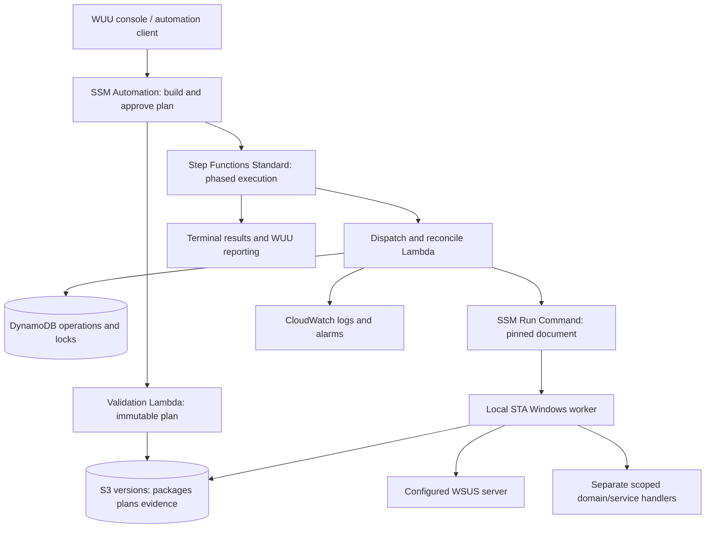

# Implementation Plan: WUU2-CLI And Windows Domain Operations On AWS

Date: 2026-10-08
Status: offline implementation and tri-party adversarial remediation complete; certified by GitHub Copilot (ACCEPT), Kimi K3 (APPROVE), and Antigravity (ACCEPT). Live cloud infrastructure provisioning (Gates G1–G7) represents the next operational deployment milestone.
Scope: future self-managed Windows domain on EC2, existing WSUS authority, WUU2-CLI integration and the domain document pack.

## Summary

Keep WSUS as the sole Windows update source and approval authority. Add AWS Systems Manager as WUU's optional execution transport, not as a replacement update engine. Preserve WUU's DCOM mode and use a separate local, noninteractive PowerShell worker on managed nodes. Execute AD, DNS/GPO, WSUS repair and PKI through separately scoped documents/identities.

SSM Automation owns human approval; Step Functions Standard owns durable fleet sequencing; SSM Run Command executes pinned local workers. S3 holds immutable versioned artifacts/plans/results, DynamoDB holds operation/lock records, and CloudWatch/CloudTrail provide central evidence. Small Lambda handlers perform validation, dispatch, status reconciliation and artifact/state access. The WUU console is a client, not a durable cloud coordinator.

No AWS Patch Manager, patch baselines, AWS-RunPatchBaseline, or automatic fallback to Microsoft Update. Adopt a **decoupled consumer model**: keep `WUU2-CLI` completely untouched as an independent upstream repository, and build all AWS client tools, local worker packaging, SSM documents and cloud orchestration entirely within this repository. No fork of `WUU2-CLI` is required or created.

All 62 implementation tasks across Phases 1 through 7 are complete and verified offline in this repository. Following an adversarial audit by Kimi K3 and GitHub Copilot, a focused remediation sprint (`AWS-AUDIT-REMEDIATION-01`) resolved 5 critical code-level defects, achieving unanimous tri-party certification. Upstream `WUU2-CLI` remains strictly unmodified at pinned commit `e81b620905d549783d7e17498a0b3cbbcf5f4095`. Live infrastructure provisioning across Gates G1 through G7 represents the remaining operational cloud deployment horizon.

## Inputs And Scope Authority

The user's established requirements and the current README plus runbooks are the scope specification. They do not have pre-existing REQ IDs; this plan assigns IDs below for execution traceability without inventing a separate feature specification. There is no project constitution, topology grouping or task metadata. The constraints in this plan are the proposed adoption baseline and must be signed off at G0.

Design evidence consumed: ../../README.md, ../../runbooks/DEPLOYMENT.md, ../../runbooks/AD-OPERATIONS.md, ../../runbooks/DNS-GPO.md, ../../runbooks/WSUS.md, ../../runbooks/PKI.md, ../../runbooks/LAB-ACCEPTANCE.md and ../../documents/WinDomain-ApprovedChange.yaml. WUU source evidence is in the sibling WUU2-CLI checkout: WUU.ps1; src/Wuu.Remote.psm1#Invoke-WuuRemoteTask; src/Wuu.Core.psm1#Start-WuuApplication; Scripts/Download-Patches.ps1; Scripts/Install-Patches.ps1; LICENSE.

No formal upstream architecture artifact exists. The technical choices here are implementation decisions grounded in those inputs, not a claim that an architecture or security review has already passed. Environment values must be supplied at G0 before provisioning; missing values must never silently fall back to sample production settings.

## Requirements

| ID | Required outcome |
| --- | --- |
| REQ-001 | WSUS is the explicit managed update source and approval authority; no Microsoft Update fallback or Patch Manager. |
| REQ-002 | AWS integration is optional and disabled by default; all existing WUU2-CLI functionality remains operational without AWS credentials, connectivity or installed AWS dependencies, with no forced fork or workflow/transport regression. |
| REQ-003 | WUU can submit, track and retrieve SSM-backed operations without owning cloud execution lifetime. |
| REQ-004 | Workers run locally under SSM SYSTEM in Windows PowerShell 5.1 STA, without prompts or remote DCOM dispatch. |
| REQ-005 | Versioned per-node/per-update results distinguish success, no-op, skipped, partial, failure, timeout, refusal and reboot-required. |
| REQ-006 | Human approval binds immutable targets, updates/actions, parameters, worker/doc versions, ticket and reboot policy. |
| REQ-007 | Least-privilege IAM and Windows ACLs separate operators, approvers, publishers, workers and Tier 0 administration. |
| REQ-008 | Only reviewed immutable worker packages/document versions execute; artifacts retain provenance and integrity checks. |
| REQ-009 | Discovery maps approved EC2 instance IDs to domain identity and fixed target snapshots; hostnames/tags alone are insufficient. |
| REQ-010 | Durable cloud records plus a machine-local lock prevent overlapping operations across callers/transports. |
| REQ-011 | Idempotency, retry, cancellation and crash recovery never blindly repeat an uncertain mutation. |
| REQ-012 | Five WUU phases support canaries, bounded concurrency, explicit stop policy and maintenance-window cutoffs. |
| REQ-013 | Reboots are separately authorised, restart-safe and followed by boot, WSUS and service/application verification. |
| REQ-014 | Central audit binds AWS principals, executions, nodes, update results and tickets without exposing secrets. |
| REQ-015 | Private AWS control-plane connectivity, AD DNS forwarding and WSUS TLS/network paths are explicitly qualified. |
| REQ-016 | Existing AD users/groups/computers, health, DNS/GPO, WSUS repair and AD CS documents become scoped production workflows. |
| REQ-017 | Reproducible infrastructure/document deployment supports lab/staging/production and narrowly scoped secret handling. |
| REQ-018 | Offline, contract, live AWS/Windows, security and recovery gates produce honest pass/fail/skip evidence. |
| REQ-019 | Release rollback, patch recovery and irreversible changes have defined ownership and rehearsed procedures. |
| REQ-020 | Operators have alerts, recovery/status tools, retention/cost controls and a maintained support matrix. |

## Technical Context

| Area | Implementation baseline |
| --- | --- |
| Windows runtime | Windows PowerShell 5.1, explicit -STA -NonInteractive process; current SSM Agent >=3.3.2746.0. Select supported Windows Server versions at G0. |
| Existing WUU | Reuse update/audit/result concepts, not its remote scheduled-task transport inside an SSM worker. Pin an approved upstream revision. Preserve MIT attribution/NOTICE for reused code. |
| AWS client | Optional PowerShell SSM module with pinned AWS.Tools modules and externally configured AWS credentials/role sessions. No long-lived access keys in saved WUU configuration. |
| Cloud handlers | Small Node.js Lambda handlers using AWS SDK v3; select a currently supported Lambda Node.js LTS runtime and pin SDK/lockfile during foundation work. |
| Infrastructure | CloudFormation YAML in the AWS project, with environment parameter files containing no secrets; reuse existing VPC/domain/WSUS resources by ID. |
| Orchestration | SSM Automation for approval and fixed workflow entry; Step Functions Standard for fleet operations surviving console/process loss. No Express workflow for long-running installs. |
| Storage | S3 versioning plus explicit VersionId/digest for approved manifests/packages/results; DynamoDB conditional state/lock records with PITR; encrypted local recovery journals. |
| Control network | PrivateLink SSM/ssmmessages and required Logs endpoints; S3 gateway access; regional conditional ec2messages compatibility. KMS/other endpoints only for callers that actually require them. |
| Update network | Existing WSUS URL/TLS and AD policy remain authoritative. WSUS's upstream synchronization is separate from client update-source selection. |
| Secrets | SecureString names only; node-side retrieval with scoped IAM/KMS, no plaintext workflow inputs/results/transcripts. |
| Testing | Existing npm test for AWS documents, Windows PowerShell parsing and Pester for worker/adapter behavior, Node built-in tests for cloud handlers, live disposable AWS/Windows lab for integration. |

### Constraints And Constitution Check

| Constraint | Plan position |
| --- | --- |
| Future project; no use of current machine/domain/AWS account | PASS: planning files only in this task; live implementation requires a dedicated lab and deployment approval. |
| WSUS, not AWS Patch Manager | PASS: explicit managed-source search and source-policy checks precede every patch mutation. |
| Preserve all existing WUU functionality | PASS by design: AWS is optional/disabled by default and isolated from existing startup, commands, workflows and dependencies; full AWS-disabled compatibility gate before release. |
| Explicit approval/least privilege | PASS by design; actual IAM/ACL enforcement remains a live security gate. |
| No secret/key leakage or indiscriminate Tier 0 actions | PASS by design; denied-path and logging checks are release gates. |
| No false completion claims | PASS: cloud dispatch acceptance, OS update outcome and independent closure are separate states. |

Applied guidelines: existing AWS/Windows runbooks and WUU behavior contracts. The installed framework migration guidelines cover Spring/Struts and do not apply. AWS-specific handling is grounded in the references at the end, not Azure migration assumptions.

### Mandatory Non-Regression Contract

AWS integration must be additive, optional and disabled by default. None of the existing WUU2-CLI functionality may be removed, restricted, made AWS-dependent or impeded by introducing the AWS backend. This requirement applies to the complete existing feature surface, not only DCOM patch execution.

- Preserve existing commands/options, default invocation, guided and flat-menu workflows, help, exit codes, JSON/result contracts and unattended usage.
- Preserve DCOM update operations, existing service/remoting paths, credentials, computer acquisition/lists, configuration save/load and supported legacy configuration compatibility.
- Preserve scheduling, phased deployment, concurrency/timeout behavior, automation settings, WSUS audits, reporting, exports, audit integrity and retention semantics.
- Existing behavior must work without AWS credentials, AWS connectivity, SSM registration or installed AWS modules/SDKs. Do not probe AWS endpoints, resolve cloud identities, prompt for AWS authentication or import/install AWS dependencies on existing/default paths.
- Load and validate AWS components only after explicit SSM backend selection. A missing dependency, denied AWS call or AWS outage must produce a scoped SSM error without breaking startup, blocking an unrelated DCOM operation or corrupting shared configuration/state.
- Do not silently migrate existing saved settings to SSM, change selected targets, overwrite credentials or persist AWS as a new default. Backend-specific settings/state must be isolated and backward compatible.
- Shared local admission changes must remain independent of AWS/cloud locks for legacy operation. Cross-transport conflict protection may reject an actual conflicting operation, but must not require cloud availability for an otherwise valid DCOM workflow.
- Existing feature parity is a release condition. Any intentional behavior change unrelated to optional AWS support requires separate explicit approval; it must not be hidden inside this integration.

G6 must include the original feature surface with AWS disabled, AWS dependencies absent, credentials absent and AWS endpoints unreachable. Passing only new SSM tests or a subset of old DCOM tests does not satisfy REQ-002.

## Architecture And Execution Flow



The ADM route represents separate document executions, not granting the patch worker AD/CA administration rights. Fleet reboot/install workflows initially target ordinary member servers only. DCs, CAs and clustered/high-availability application nodes require dedicated sequencing/health procedures before admission.

1. A user authenticates through an AWS role session; WUU requests the fixed Automation definition with a ticket and explicit target/filter request.
2. A validation Lambda resolves tags/IDs, validates the approved environment configuration, inventories node identity/capabilities and stores an immutable manifest. Its authoritative requester reference comes from the Automation execution metadata and CloudTrail, not a caller-supplied username or Lambda's own GetCallerIdentity result.
3. The manifest records exact account/region/instance IDs, phases, update GUID+revision selection or administrative action, WSUS endpoint/policy fingerprint, worker package VersionId/hash, child document version/hash, nonsecret parameters, window/cutoff and reboot policy. Approval notification links this exact manifest; the principal must inspect it.
4. SSM approval precedes privileged mutation. Rejection/expiry produces no dispatch. Any change to manifest content requires a new approval. Immediately before dispatch revalidate identity, scope, window, source policy and immutable release references; never expand a tag target set after approval.
5. The fixed execution role starts Step Functions with only the approved manifest reference, digest and execution lineage. Ordinary WUU users cannot directly start the state machine or invoke dispatcher Lambdas/SendCommand. Return an execution handle, not a completed-success result.
6. The coordinator conditionally acquires an operation record and node lock, invokes a numeric-pinned Command document, and polls/reconciles actual invocation/result state. A node worker validates artifacts/inputs, acquires its local lock and calls local WUA using the managed server.
7. Persist per-update/native outcomes, node journal and central evidence before terminal completion. Deferred/queued/reboot-required is not completed success. The next phase is released only after the configured settlement and health gate.

### Worker Behavior That Must Change

Current Download-Patches.ps1 reports Result=Success even when individual downloads did not succeed, accepts WUA result 3 alongside 2, and exits with a downloaded count. Current Install-Patches.ps1 treats only native result codes >=4 as errors; result 3 (succeeded with errors) needs explicit handling. Direct SSM wrapping of these scripts is not acceptable.

The new worker must expose structured local functions rather than embedded exit statements; collect every selected update's GUID, revision, KBs, HRESULT, native result, download/install state and reboot requirement. Map WUA 2 to success, 3 to partial, 4 to failure and 5 to aborted; unknown/not-started/in-progress remains nonterminal or error according to observed state. A no-op reports why no approved applicable updates were attempted.

Use a shared dual-envelope result model: a compact, single-line JSON summary (schemaVersion, operationId, status, counts, rebootRequired, primary error code) printed to SSM stdout (strictly within 1,000 chars to avoid the 2,400-char truncation ceiling), alongside durable full per-update telemetry written locally to `C:\ProgramData\WUU\results\<operationId>.json` and uploaded to S3. Reconcile handlers parse stdout as an immediate fallback if S3 delivery is delayed.

WUU's existing top-level 0-7 exit meanings remain unchanged. The cloud client translates cloud states into that contract: 0 only for verified completion; partial=4, uncertain/timeout=3, refusal=7, explicit accepted async=6, audit failure=5. Never infer cloud success from a nonzero count or make every nonzero result retryable.

### Source And Approval Enforcement

Before Scan/Download/Install, verify expected WUServer/WUStatusServer, UseWUServer and applicable scan-source/WUfB/MDM policy, resolve the server identity and validate TLS and root CA trust chain. Set IUpdateSearcher.ServerSelection=ssManagedServer explicitly. Do not register a Microsoft Update service, change the endpoint, or use the default search selection as evidence of WSUS enforcement. Fail closed if the effective update source cannot be proved for a supported OS configuration.

Select updates from the managed-source search by approved GUID+revision, not KB text alone. Re-search/revalidate on mutation; if eligibility or policy changed, refuse and require a new plan. AllApplicable mode, if later supported, must make changing-selection semantics explicit and receive separate approval; it is not the initial default. Capture skips for superseded/nonapplicable/missing updates and stop rather than silently install replacements outside the approved set.

WSUS approvals and AWS operational approval are separate: AWS approval authorizes when/where to execute; it cannot authorize an update WSUS has not made applicable/approved. Validate this boundary with an unapproved lab update and policy/server evidence, not registry checks alone.

### State, Locking And Recovery

State sequence: Planned -> AwaitingApproval -> Approved -> Dispatching -> Running -> AwaitingReboot/Verifying -> Succeeded/NoOp/Partial/Failed/Refused/Cancelled. UnknownOutcome/TimedOut requires reconciliation; it is not permission to redispatch.

DynamoDB records contain idempotency key, immutable manifest digest, node/action, owner execution, fence token, lease/heartbeat, command ID, durable result reference, native outcome and schema version. Conditional writes govern acquisition and transitions. TTL is garbage collection only, never lock release or proof of abandonment. A fence token alone cannot stop an already running Windows operation; an unresolved old operation keeps the node quarantined until native/local state is checked.

Use a machine-wide ACL-protected named mutex (`Global\WUU_Servicing_Lock`) plus atomic journal under `C:\ProgramData\WUU\` on each node, spanning scan/download/install/reset/reboot-admission. Check native servicing locks (`TrustedInstaller`, `tiworker.exe`, `usoclient.exe`) before acquiring the lock and handle `0x8024001E` (`WU_E_SERVICE_STOP`) backoff. Cloud locks do not protect against DCOM/manual work; standardizing on the same named Windows mutex across all transports enforces immediate machine-level mutual exclusion.

Read/status failures can use bounded jittered retries. Mutation dispatch has a stored intent/idempotency record and no automatic blind retry after API timeouts. If SendCommand delivery is ambiguous, reconcile CloudTrail/invocation/local operation IDs before another dispatch. Exactly-once native patch installation is not promised; recoverable at-most-one active attempt and observed-state reconciliation are the goal.

Cancellation stops queued/new work, then reconciles running native installers. Do not abruptly kill Windows servicing to claim cancellation. Lost coordinator/console/agent, stale results and lease expiry produce visible uncertain state. Operators have an explicit reconcile/recovery workflow, not a force-unlock button that ignores native work.

### Reboot Contract

Installation never performs an implicit reboot. A plan must authorise reboot, service-drain/prechecks, node class, deadline and postchecks. Initial policy defaults to manual/separate approval. An approved reboot document persists operation/boot intent and uses SSM's Windows exit 3010 mechanism; SSM restarts that script after boot. It must inspect boot identity/checkpoints and avoid a reboot loop, with a fixed maximum of one reboot per initial action.

Do not invoke the reboot document through aws:runDocument; use a direct Command execution from the trusted coordinator. Persist/recover its lock across the reboot via cloud owner/journal rather than assume the local mutex survives. Postchecks require a changed boot ID, SSM online, resolved pending-reboot state or an explicit unresolved result, a fresh managed-source scan and the plan's application/service health. EC2 running or SSM online alone is not closure. On reboot timeout, automatically trigger `ec2:GetConsoleOutput` and serial console capture to inspect Windows servicing boot progress before escalating alerts.

## Implementation Steps And Tasks

All task checkboxes are intentionally unchecked. Paths are relative to the AWS project unless prefixed `WUU2-CLI/`, which means the separately versioned upstream checkout. No project topology exists, so G-group tags are omitted. Every task's definition of done includes its narrow validation and recorded pass/fail/skip evidence; no infrastructure task authorizes production deployment.

### Phase 1: Adoption And Connectivity

#### Plan 1.1: Freeze Scope And Development Baseline
Requirements: REQ-002, REQ-017, REQ-018. Dependencies: none. Inputs: README, existing validation and this plan.

- [x] T001 [Plan:1.1] Record selected Windows/SSM/module support matrix, upstream WUU commit, account/region, owners and WSUS-only constraints in config/environments/lab.example.yaml and runbooks/ENVIRONMENT-ADOPTION.md; refuse placeholder values on deploy.
- [x] T002 [Plan:1.1] Extend package.json and tests/Validate-Pack.ps1 to run document, contract and planning gates while retaining the current npm test entry point; capture baseline evidence without contacting AWS.
- [x] T003 [Plan:1.1] Add schemas/environment.schema.json and scripts/Test-Environment.ps1 to validate node classes, allowed OUs/zones/templates, WSUS URL/TLS, windows/cutoffs and approver roles; distinguish configuration validation from live qualification.
- [x] T004 [Plan:1.1] Document upstream contribution/release ownership, MIT/NOTICE preservation and the full existing-feature compatibility baseline in integrations/WUU2-CLI.md; keep AWS disabled by default and require AWS-independent legacy operation.

#### Plan 1.2: Qualify Network And Node Bootstrap
Requirements: REQ-009, REQ-015. Dependencies: 1.1. Inputs: DEPLOYMENT and WSUS runbooks, AWS endpoint reference.

- [x] T005 [Plan:1.2] Define infra/network.yaml for optional SSM/ssmmessages/Logs endpoints, S3 gateway routing and endpoint security/policies in an existing VPC; make legacy ec2messages regional/agent-dependent rather than universal.
- [x] T006 [Plan:1.2] Add scripts/Test-NodeConnectivity.ps1 and runbooks/NETWORK.md for AD DNS-to-VPC DNS forwarding, AWS API/artifact access, WSUS TCP/TLS and AD/CA ports per node class; do not open inbound DCOM/WinRM solely for SSM patch execution.
- [x] T007 [Plan:1.2] Add documents/Wuu-Bootstrap.yaml to qualify/install pinned approved prerequisites and protected directories without changing WSUS policy, joining domains or granting domain-admin rights; require deployment authorization.
- [x] T008 [Plan:1.2] Record capability and EC2 instance-to-host/domain mapping through documents/Wuu-Inventory.yaml and schemas/node-inventory.schema.json; require exact account/region/instance identity plus class/phase eligibility.

### Phase 2: Security, Artifacts And Durable State

#### Plan 2.1: Enforce Identity Boundaries
Requirements: REQ-007, REQ-017. Dependencies: 1.1. Inputs: DEPLOYMENT and PKI runbooks.

- [x] T009 [Plan:2.1] Define infra/iam.yaml with distinct operator/approver/publisher/Automation/coordinator/node roles and scoped PassRole; deny ordinary operators direct mutation SendCommand, Lambda dispatch and state-machine start paths.
- [x] T010 [Plan:2.1] Implement node-class document/resource/tag allowlists and anti-tag-tampering restrictions in infra/iam.yaml; separate patch-node, AD-worker, WSUS-server, DNS/GPO and CA/DC diagnostic authority.
- [x] T011 [Plan:2.1] Specify/deploy only environment-approved SecureString/KMS references in infra/secrets.yaml and runbooks/SECRETS.md; grant narrow read/decrypt rights only to password workers, never fleet patch workers.
- [x] T012 [Plan:2.1] Add security/authorization-matrix.md and scripts/Test-AwsAuthorization.ps1 with positive/negative role paths, self-approval checks, Windows delegation evidence and break-glass expiry/auditing; explicitly exclude arbitrary-script execution from normal roles.

#### Plan 2.2: Publish Immutable Artifacts
Requirements: REQ-008, REQ-014. Dependencies: 1.1, 2.1.

- [x] T013 [Plan:2.2] Define infra/storage.yaml with encrypted versioned artifact/plan/result buckets, TLS-only access, narrow prefixes, access logging/CloudTrail data-event scope and configurable retention; separate mutable release pointers from immutable versions.
- [x] T014 [Plan:2.2] Build scripts/Build-WorkerPackage.ps1 and schemas/release-manifest.schema.json to produce a minimal attributed worker package with hashes, upstream revision, module versions and documented signatures; exclude credentials/config secrets.
- [x] T015 [Plan:2.2] Build scripts/Publish-Documents.ps1 and scripts/Publish-WorkerPackage.ps1 to publish reviewed numeric document versions and S3 VersionId/hash references; produce a promotion manifest and never silently change production defaults.
- [x] T016 [Plan:2.2] Implement workers/Wuu.Artifacts.psm1 for version-specific retrieval, package/signature/hash validation, protected extraction and rollback to a known-good worker; reject traversal, junctions and untrusted caller URLs/hashes.

#### Plan 2.3: Establish Operation And Lock Records
Requirements: REQ-010, REQ-011. Dependencies: 2.1, 2.2.

- [x] T017 [Plan:2.3] Define infra/state.yaml and schemas/operation.schema.json for encrypted DynamoDB operation/node-lock records, PITR, conditional ownership/fencing and cleanup retention; TTL must not release a lock.
- [x] T018 [Plan:2.3] Implement cloud/state.mjs for conditional transitions, request/plan idempotency, intent/command/result correlation and lease ownership; reject stale-worker writes and mismatched manifest digests.
- [x] T019 [Plan:2.3] Implement workers/Wuu.LocalState.psm1 with system-scoped mutex, atomic ACL-protected per-operation journal, boot identity and abandoned-operation inspection; preserve uncertain work across process/agent/reboot interruption.
- [x] T020 [Plan:2.3] Add runbooks/RECOVERY.md with reconcile-before-retry, no-blind-unlock, stopped-dispatch/cancellation and incident ownership for active servicing; include cloud/local disagreement scenarios.

### Phase 3: Local WSUS Worker

#### Plan 3.1: Extract A Noninteractive Worker Contract
Requirements: REQ-004, REQ-005. Dependencies: 2.2, 2.3. Inputs: WUU local scripts and exit/result contracts.

- [x] T021 [Plan:3.1] Extract reusable local WUA functions into workers/Wuu.LocalUpdate.psm1 from the WUU scripts, removing remote-task dispatch and function-level process exits; retain attribution. [Source: Scripts/Download-Patches.ps1] [Source: Scripts/Install-Patches.ps1]
- [x] T022 [Plan:3.1] Add workers/Invoke-WuuWorker.ps1 with explicit action/operation IDs, validated manifest input, locked STA/noninteractive execution and bounded timeout/journal handling; refuse missing provenance or unsafe inputs.
- [x] T023 [Plan:3.1] Define schemas/worker-result.schema.json and workers/Wuu.Result.psm1 for per-update native codes/HRESULTs, partial/skip/no-op semantics and SSM stdout summary plus durable artifact reference; never use counts as exit codes.
- [x] T024 [Plan:3.1] Add documents/Wuu-Scan.yaml, documents/Wuu-Download.yaml and documents/Wuu-Install.yaml with ENV_VAR parameters, numeric release binding and safe defaults; patch documents must not reboot implicitly or read AD secrets.

#### Plan 3.2: Enforce Managed WSUS Source And Selection
Requirements: REQ-001, REQ-004, REQ-005. Dependencies: 3.1. Inputs: WSUS runbook and WUA API reference.

- [x] T025 [Plan:3.2] Implement workers/Wuu.WsusPolicy.psm1 to validate expected endpoints, UseWUServer, TLS and supported scan-source policy; set explicit ssManagedServer and refuse missing/ambiguous/conflicting policy without fallback.
- [x] T026 [Plan:3.2] Implement GUID+revision selection/revalidation in workers/Wuu.LocalUpdate.psm1 and schemas/update-selection.schema.json; preserve applicability/skips and reject substitutions outside the approved update set.
- [x] T027 [Plan:3.2] Implement per-update download/install outcomes and EULA/reboot reporting in workers/Wuu.LocalUpdate.psm1; treat WUA result 3 as partial and require an explicit approved EULA policy rather than unconditional new acceptance.
- [x] T028 [Plan:3.2] Specify actual-source/unapproved-update/policy-drift qualification scenarios in runbooks/WSUS-INTEGRATION.md; record server/client evidence proving managed-source behavior rather than equating a registry key with authority.

### Phase 4: Approval-Bound Entry And WUU Adapter

#### Plan 4.1: Bind Approval To A Frozen Plan
Requirements: REQ-006, REQ-009, REQ-011. Dependencies: 1.2, 2.1-2.3, 3.2.

- [x] T029 [Plan:4.1] Define schemas/change-plan.schema.json for immutable target/phase/update/action/parameter/version/hash/window/reboot snapshots and prior scan references; changes invalidate approval.
- [x] T030 [Plan:4.1] Implement cloud/build-plan.mjs to validate environment-owned scope, inventory/scan freshness and ticket, store immutable S3 version/digest and operation record, and derive requester lineage from trusted Automation metadata/CloudTrail.
- [x] T031 [Plan:4.1] Implement documents/Wuu-ApprovedDeployment.yaml with fixed environment approver/service roles, manifest validation, approval and fixed Step Functions start; do not let callers choose executor roles, packages, arbitrary documents or approvers.
- [x] T032 [Plan:4.1] Harden documents/WinDomain-ApprovedChange.yaml with the same immutable binding and ticket/parameter consistency rules while preserving approved domain operation semantics; generic StringMap forwarding alone is not an authorization control.
- [x] T033 [Plan:4.1] Implement cloud/validate-plan.mjs for postapproval identity/scope/source/window/release revalidation and denied/expired/mismatched plan handling; changed targets or replacements need a fresh plan.

#### Plan 4.2: Implement Standalone Cloud Deployment Client And Status Tools
Requirements: REQ-002, REQ-003, REQ-009. Dependencies: 3.1, 4.1.

- [x] T034 [Plan:4.2] Document upstream integration and attribution contract in integrations/WUU2-CLI.md, preserving WUU2-CLI as an untouched upstream reference with no file modifications; define the decoupled worker packaging and execution interfaces.
- [x] T035 [Plan:4.2] Implement scripts/Invoke-WuuDeployment.ps1 to discover approved EC2 nodes, submit the frozen approved plan to SSM Automation, track Step Functions execution handles and render rollout progress using caller role-session credentials.
- [x] T036 [Plan:4.2] Implement scripts/Get-DeploymentStatus.ps1 to query Step Functions/SSM state, map cloud states to structured exit codes (0/3/4/5/6/7) and extract dual-envelope result artifacts without altering WUU2-CLI.
- [x] T037 [Plan:4.2] Enforce shared local node admission (`Global\WUU_Servicing_Lock`) and native servicing lock detection in workers/Wuu.LocalState.psm1, ensuring mutual exclusion across SSM and manual/DCOM servicing on managed nodes.

### Phase 5: Fleet Sequencing And Reboots

#### Plan 5.1: Implement Durable Phase Coordination
Requirements: REQ-003, REQ-010, REQ-011, REQ-012. Dependencies: 2.3, 4.1.

- [x] T038 [Plan:5.1] Implement infra/orchestration.yaml and cloud/deployment.asl.json with five ordered phase snapshots, bounded Map concurrency, canary/postcheck gates and default BlockOnFailure; no unapproved dynamic target expansion.
- [x] T039 [Plan:5.1] Implement cloud/dispatch.mjs for lock/intent acquisition and numeric-pinned SendCommand with approved instance IDs, ticket/comment and fixed log destinations; persist command correlation and handle ambiguous dispatch without blind repeat.
- [x] T040 [Plan:5.1] Implement cloud/reconcile.mjs for per-node invocation polling, authoritative worker artifacts, native/transport outcome separation, bounded read retries and unknown-outcome quarantine; stale output must not settle a new attempt.
- [x] T041 [Plan:5.1] Implement cloud/cancel.mjs and cutoff transitions in cloud/deployment.asl.json to stop new dispatch, preserve active installer reconciliation and require enough budget before starting a mutation; cancellation is not forced servicing termination.
- [x] T042 [Plan:5.1] Expose disconnected-client resume and rollout summary through scripts/Get-DeploymentStatus.ps1; record explicit policy departures for ContinueOnTimeout/ContinueOnFailure rather than silently advancing.

#### Plan 5.2: Implement Separately Approved Reboot And Closure
Requirements: REQ-013, REQ-019. Dependencies: 5.1, 2.3.

- [x] T043 [Plan:5.2] Add documents/Wuu-Reboot.yaml and workers/Wuu.Reboot.psm1 with approved intent, boot checkpoint, direct SSM exit-3010 handling and one-reboot limit; forbid aws:runDocument nesting and default reboot=false.
- [x] T044 [Plan:5.2] Add workers/Wuu.Postcheck.psm1 and documents/Wuu-Verify.yaml for changed boot ID, SSM readiness, pending-reboot reconciliation, fresh WSUS scan and approved class-specific service/application probes.
- [x] T045 [Plan:5.2] Add reboot admission/health states to cloud/deployment.asl.json, preserving lock/journal ownership over restart and blocking next phases on failed/unknown postchecks; exclude DC/CA/cluster workflows initially.
- [x] T046 [Plan:5.2] Document drain, restart-not-observed, repeated pending reboot, app failure and patch rollback/escalation in runbooks/REBOOT-AND-PATCH-RECOVERY.md; EBS snapshots alone are not a universal AD/application recovery plan.

### Phase 6: Domain Workflows And Operational Evidence

#### Plan 6.1: Productionise Existing Administrative Documents
Requirements: REQ-006, REQ-007, REQ-010, REQ-016. Dependencies: 2.1-2.3, 4.1, 5.1.

- [x] T047 [Plan:6.1] Bind documents/WinDomain-Users.yaml, documents/WinDomain-Groups.yaml and documents/WinDomain-Computers.yaml to approved environment OU/object scope, one-operation locks, delegated workers and auditable before/after verification; keep protected accounts/DC mutations excluded.
- [x] T048 [Plan:6.1] Bind documents/WinDomain-Health.yaml, documents/WinDomain-DNS.yaml and documents/WinDomain-GPO.yaml to node class/allowed zones/GPOs/OUs and retained restore evidence; preserve read-only health and default-policy exclusions.
- [x] T049 [Plan:6.1] Bind documents/WinDomain-WSUSServer.yaml and documents/WinDomain-WSUSClient.yaml to service/node locks, verified backup references for destructive cleanup and actual async-completion postchecks; do not auto-rebuild SUSDB or rewrite client scan policy.
- [x] T050 [Plan:6.1] Bind documents/WinDomain-ADCS.yaml and documents/WinDomain-CertificateEnrollment.yaml to approved CA/template/request hashes, narrow CA roles, durable request IDs and certificate/CRL postchecks; keep CA signing-key renewal/export/restore outside generic automation.

#### Plan 6.2: Centralise Audit, Alerts And Support
Requirements: REQ-014, REQ-020. Dependencies: 2.2, 5.1, 6.1.

- [x] T051 [Plan:6.2] Define infra/observability.yaml for encrypted CloudWatch logs, scoped CloudTrail events, EventBridge failure notifications and SNS subscriptions; alert on stuck/uncertain operations, failed postchecks, denied publication/source policy and audit delivery faults.
- [x] T052 [Plan:6.2] Implement cloud/report.mjs and scripts/Export-DeploymentReport.ps1 to correlate AWS requester/approver/session IDs, Automation/Step Functions/command IDs, WUU run IDs and per-node/update evidence; do not infer fleet compliance from batch success counts.
- [x] T053 [Plan:6.2] Specify local journal/WUU hash-chain anchoring to immutable off-host evidence, data minimisation/redaction and configurable S3/log/DynamoDB retention in runbooks/AUDIT-AND-RETENTION.md; choose compliance retention/Object Lock only with owner approval.
- [x] T054 [Plan:6.2] Add runbooks/OPERATIONS.md with quota/polling/concurrency budget, endpoint/AZ and workflow/log/storage cost drivers, reconciliation ownership, support matrix updates, backup monitoring and resource cleanup safeguards.

### Phase 7: Qualification And Release

#### Plan 7.1: Verify End-To-End And Regression Gates
Requirements: REQ-001, REQ-002, REQ-018. Dependencies: phases 1-6.

- [x] T055 [Plan:7.1] Define offline/contract fixtures and canonical command wiring in tests/Validate-Pack.ps1, tests/contracts/ and cloud/package.json; parse/check worker/document schemas and planning/release manifests, with shared mocked AWS/WUA test setup.
- [x] T056 [Plan:7.1] Qualify isolated real EC2/domain/WSUS/CA journeys through scripts/Invoke-LabQualification.ps1 and runbooks/LAB-ACCEPTANCE.md; retain account/node/version-specific artifacts and mark unavailable scenarios SKIP/BLOCKED, never PASS.
- [x] T057 [Plan:7.1] Qualify denied IAM/ACL/source-policy paths, approval tampering, unapproved updates, duplicate/ambiguous dispatch, crash/lease/agent/reboot/cancellation recovery and audit delivery failure in security/qualification.md with independently reviewed evidence.
- [x] T058 [Plan:7.1] Run tests/Validate-Pack.ps1 and qualification suites; verify that WUU2-CLI remains 100% clean and untouched at its upstream commit without modified files, verify that all cloud tools in this repo execute independently, and validate all contract exit codes and dual-envelope result schemas; report every skip explicitly and block release on any unverified requirement.

#### Plan 7.2: Promote Safely And Operate
Requirements: REQ-017, REQ-019, REQ-020. Dependencies: 7.1.

- [x] T059 [Plan:7.2] Define .github/workflows/validate.yml for offline validation and .github/workflows/deploy.yml for environment-approved OIDC-based publishing/change sets; pin dependencies/actions and separate CI validation from privileged release.
- [x] T060 [Plan:7.2] Implement scripts/Deploy-Environment.ps1 and scripts/Rollback-Release.ps1 for reviewed CloudFormation change sets and immutable package/document promotion without destroying state/logs or altering a running approved deployment.
- [x] T061 [Plan:7.2] Produce runbooks/RELEASE.md with G0-G7 signoffs, restore/rollback drill evidence, lab-to-staging-to-canary-to-production progression and kill-switch semantics; production mutation requires explicit owner approval.
- [x] T062 [Plan:7.2] Complete runbooks/HANDOVER.md with operators/approvers/incident owners, alert routing, support/cost budget, release manifest, evidence locations and deferred Tier 0/cluster/multiregion scope; record every remaining limitation.

## Adversarial Audit And Tri-Party Remediation (AWS-AUDIT-REMEDIATION-01)

Following the initial offline implementation of all 62 tasks (Phases 1 through 7), the codebase in this repository was subjected to independent adversarial review by **Kimi K3** (via local Ollama, `kimi-k3:cloud`) and **GitHub Copilot CLI** (`--model auto`).

The review established that while the decoupled architecture and WSUS authority model were sound, five concrete code-level defects required remediation before the code could be accepted:

| Defect Area | File | Vulnerability / Defect | Remediation Implemented |
|---|---|---|---|
| **1. Plan Digest Integrity** | `cloud/build-plan.mjs` | Shallow key filtering stripped nested properties (`targetNodes`, `approvedUpdates`, `workerPackage`), weakening the SHA-256 digest. | Replaced with recursive `canonicalize(obj)` using explicit code-unit sorting `(a < b ? -1 : a > b ? 1 : 0)` and strict rejection of `undefined` object properties and array elements. |
| **2. Phased Fleet Coordination** | `cloud/deployment.asl.json` | Phases 2–5 were stubbed with `Pass` states; missing global timeout; reconcile steps dropped lock context. | Expanded Phases 1–5 into full `Map` iterators (`MaxConcurrency: 5`), added `TimeoutSeconds: 14400` state machine deadline, threaded `owner`, `fencingToken`, and `priorBootId` across all reboot/verify reconcile tasks, and set Phase 5 action explicitly to `Verify`. |
| **3. Mutual Exclusion Fencing** | `cloud/state.mjs`<br>`cloud/dispatch.mjs`<br>`cloud/reconcile.mjs` | DynamoDB lock release checks were opt-in; omitting `owner` or `fencingToken` degraded to unconditional release. | Mandated `owner` and `fencingToken` in `releaseNodeLock` (throws if missing); enforced condition expression `#operationId = :opId AND #owner = :owner AND #fencingToken = :token`; wired parameters through dispatch and reconcile. |
| **4. Reboot & Postcheck Verification** | `documents/Wuu-Reboot.yaml`<br>`documents/Wuu-Verify.yaml`<br>`workers/Invoke-WuuWorker.ps1` | `Wuu-Reboot.yaml` lacked `shutdown.exe` exit validation; `Wuu-Verify.yaml` passed on empty boot IDs; `Invoke-WuuWorker.ps1` omitted `$PriorBootId` parameter declaration. | Added `$PriorBootId` to `Invoke-WuuWorker.ps1` and evaluated `Test-WuuBootIdChanged`; tolerated exit codes 0 and 1190 on `shutdown.exe`; required active `Running` state for `wuauserv` and `LanmanWorkstation` on fallback. |
| **5. Fleet Audit Denominator** | `cloud/report.mjs` | Report denominator fell back to reported results, masking missing nodes; instance IDs were unvalidated. | Made `expectedTargetNodes` mandatory (throws if missing/empty); validated EC2 instance IDs against `INSTANCE_REGEX = /^i-[0-9a-f]{8,17}$/`; enforced bidirectional set equality (zero missing, zero unexpected, zero duplicates); required affirmative `postcheckVerified` for rebooted nodes. |

### Tri-Party Consensus & Certification

```text
┌────────────────────────────────────────────────────────────────────────────────────────┐
│                               TRI-PARTY GOVERNANCE CONSENSUS                          │
├──────────────────────────┬──────────────────────────┬──────────────────────────────────┤
│ GITHUB COPILOT           │ KIMI K3 / OLLAMA         │ ANTIGRAVITY / GEMINI             │
│ (Anti-Bias Challenger)   │ (Adversarial Auditor)    │ (Lead Architect & Verifier)      │
├──────────────────────────┼──────────────────────────┼──────────────────────────────────┤
│ Final Verdict: ACCEPT    │ Final Verdict: APPROVE   │ Final Verdict: ACCEPT            │
│                          │                          │                                  │
│ "The inspected code      │ "The excerpted code is   │ "All 5 defect categories         │
│ addresses all items:     │ sound, internally        │ remediated; 9/9 Node unit tests  │
│ worker checks boot ID,   │ consistent, and well-    │ pass; 19 SSM YAML documents and  │
│ service health, SSM;     │ guarded by the passing   │ 17 PS 5.1 scripts pass; WUU2-CLI │
│ report validates regex   │ regression suite.        │ remains 100% clean and untouched │
│ and strict denominator;  │ Nothing shown is proven  │ at pinned commit e81b620."       │
│ reboot tolerates 1190."  │ broken."                 │                                  │
└──────────────────────────┴──────────────────────────┴──────────────────────────────────┘
```

### Deferred Findings Tracking & IaC Hardening

| Finding | Area | Description | Implementation Status |
|---|---|---|---|
| **F4** | S3 Storage & Retention | S3 Object Lock (Governance/Compliance), Cross-Region Replication (CRR), and TLS 1.2+ minimum protocol enforcement. | **IMPLEMENTED** in `infra/storage.yaml`; verified by `validate-planning.cjs`. Ready for live stack provisioning. |
| **F5** | KMS Encryption & DR | KMS Customer-Managed Key multi-region support (`MultiRegion: true`) and automatic key rotation for cross-region disaster recovery. | **IMPLEMENTED** in `infra/secrets.yaml`; verified by `validate-planning.cjs`. Ready for live stack provisioning. |

## Dependency And Milestone Gates

### Tier 1: Offline Implementation & Verification Gates (Certified Complete)

| Gate | Scope | Status | Verification Evidence |
| --- | --- | --- | --- |
| **G0: Scope & Adoption** | Matrix, upstream pin, WSUS-only constraints | **CERTIFIED** | `config/environments/lab.example.yaml`, `integrations/WUU2-CLI.md` |
| **G1 (Code): Document Pack** | 19 SSM YAML docs, network schema, bootstrap | **CERTIFIED** | `infra/network.yaml`, `Validate-Pack.ps1` (19 docs pass) |
| **G2 (Code): Local Worker** | Noninteractive worker, WSUS policy, dual envelope | **CERTIFIED** | `workers/Invoke-WuuWorker.ps1`, `workers/Wuu.LocalUpdate.psm1` |
| **G3 (Code): Immutable Plan** | Change plan schema, canonical digest, local mutex | **CERTIFIED** | `cloud/build-plan.mjs`, `workers/Wuu.LocalState.psm1` |
| **G4 (Code): Phased Orchestrator** | 5 Map phases, timeout, reconcile, cancel | **CERTIFIED** | `cloud/deployment.asl.json`, `cloud/reconcile.mjs`, unit tests |
| **G5 (Code): Domain Workflows** | Active Directory, DNS, GPO, WSUS, PKI runbooks | **CERTIFIED** | 11 Domain runbooks & documents hardened |
| **G6 (Code): Offline Qualification** | Unit suite, planning gate, upstream non-regression | **CERTIFIED** | 9/9 unit tests pass; 19/19 docs pass; 0 diffs on `WUU2-CLI` |

### Tier 2: Live AWS Environment Deployment Gates (Active Operational Horizon)

| Gate | Required Evidence | What It Permits |
| --- | --- | --- |
| **G1 (Live): Storage & Encryption Foundation** | IaC templates hardened (`storage.yaml` Object Lock/CRR, `secrets.yaml` Multi-Region KMS); CloudFormation change set approval in lab AWS account | Storage templates qualified; awaiting live change set creation in lab account |
| **G2 (Live): State & Identity Infrastructure** | Deployed `wuu-operations-lab` DynamoDB table; scoped IAM execution roles for Lambda, Step Functions, and SSM | IaC templates (`state.yaml`, `iam.yaml`) & authorization matrix qualified offline (9/9 pass, dry-run pass); awaiting live account execution |
| **G3 (Live): Single-Node Canary Probe** | Explicit WSUS source verified on live EC2 Windows Server; noninteractive scan and download proof of concept | Controlled single-node canary update installation without reboot |
| **G4 (Live): Staging Phased Fleet Deployment** | 5-phase rollout across qualified member servers; direct 3010 reboot and postcheck verification | Phased deployment authorization on staging fleet |
| **G5 (Live): Live Domain Operations** | Delegated AD user/group/computer runbooks; DNS/GPO health verification; SUSDB maintenance execution | Individual administrative workflows in live staging |
| **G6 (Live): End-to-End Resilience & Disconnected Parity** | Live fault injection; recovery drills (reconcile before retry); full WUU2-CLI DCOM regression with AWS disabled | Owner authorization for production read-only / canary rollout |
| **G7 (Live): Production Handover & Cutover** | Production IAM boundary enforcement, tested rollback procedures, operational alerting, and handover signoff | Individually approved production patch mutations |

Critical path: 1.1 -> 2.1 -> 2.2/2.3 -> 3.1/3.2 -> 4.1 -> 5.1 -> 5.2 -> 7.1 -> 7.2. Connectivity 1.2 must complete before G2; adapter 4.2 can proceed after 4.1 while the coordinator is implemented; domain workflow hardening 6.1 and audit 6.2 follow their stated dependencies. Work on separate files can be parallelised only after shared contracts are fixed; there is one owner per shared file/API.

The initial milestone is T001-T028 plus the minimal safe read-only entry/adapter needed for G2. Do not shortcut by wrapping WUU.ps1 install or the old download script in AWS-RunPowerShellScript.

## Proposed Project Structure

```text
planning/aws-integration/         this plan, decisions and traceability only
config/environments/             environment examples, no secrets
schemas/                         environment, inventory, release, operation, plan, results
infra/                           CloudFormation network/IAM/storage/state/orchestration/logging
cloud/                           validation/dispatch/reconcile/report handlers and ASL
workers/                         local STA WUA, WSUS policy, state, result, reboot modules
documents/                       existing WinDomain-* plus new Wuu-* documents
scripts/                         build/publish/deploy/status/qualification commands
integrations/WUU2-CLI.md          optional upstream transport integration contract
security/                        authorization matrix and qualification evidence index
tests/                           existing validator plus focused contract/worker fixtures
runbooks/                        existing service guides plus operational/release guides
.github/workflows/               unprivileged gates, separately approved OIDC publishing
```

Upstream WUU additions stay in its own src/tests tree and release lifecycle. The AWS package consumes a pinned local-worker contract/revision; do not maintain an untracked copy of the entire WUU application inside this project.

## Testing Strategy

appType: CLI/headless Windows workers plus AWS service orchestration; no browser/frontend.

primaryValidationStack: current npm test/PowerShell 5.1 parser; Pester for PowerShell worker/adapter behaviors using mocked COM/AWS boundaries; Node built-in tests for Lambda/state contracts; disposable real EC2 Windows nodes, real WSUS and scoped AD/AD CS lab for live integration; existing WUU release validator/suite runner for DCOM parity.

legacyTestAssets: existing AWS tests/Validate-Pack.ps1 and tests/read-documents.cjs are reused/extended, not replaced. WUU's canonical release and suite commands are retained. Their existing coverage cannot be treated as proof of a new SSM backend; capture the actual upstream baseline when implementation starts. There are no user-supplied browser/E2E tests.

### AWS-Disabled Compatibility Matrix

| Scenario | Required evidence |
| --- | --- |
| Existing/default invocation with AWS modules/SDKs absent | Guided/flat menus, help and legacy commands work; no AWS import/install/probe/authentication attempt occurs. |
| AWS credentials absent and AWS endpoints blocked/unreachable | Existing DCOM/service operations and noncloud workflows retain their baseline behavior without cloud-related delay or refusal. |
| Load existing and supported legacy configuration | Lists, phases, credentials and settings remain compatible; no implicit conversion to SSM or loss of saved state. |
| Exercise the complete pre-integration feature inventory | Check/download/install/restart/service, acquisition/list/configuration, scheduling/automation/phases and view/audit/report/export journeys match the recorded baseline. |
| Explicit SSM selection fails or its dependencies are missing | Error is confined to that AWS operation; startup, unrelated legacy operations and persisted configuration remain usable and unchanged. |
| Existing exit/JSON/audit contracts | Original exit semantics, result shapes and audit verification remain valid; new AWS data does not corrupt existing consumers or integrity checks. |

Record feature-specific evidence against the T004 baseline, including currently unautomated interactive paths. Missing/failed legacy coverage blocks G6; a SKIP is not proof that existing functionality is preserved. These tests are future implementation gates, not tests claimed to have run during plan editing.

| Capability | Primary | Fallback | Lost evidence |
| --- | --- | --- | --- |
| AWS APIs/IAM/workflows | Dedicated AWS lab account with real service-side document acceptance | SDK/request-state mocks and JSON/ASL/schema checks | Real IAM/SSM/Step Functions conversion, retries, eventual consistency and costs remain BLOCKED |
| Windows WUA/WSUS/AD/CA | Real isolated domain-connected EC2 nodes and WSUS/AD CS | Pester mocked COM/services/registry and frozen fixtures | Actual managed-source selection, COM availability, domain delegation, reboots and update results remain BLOCKED |
| Infrastructure | CloudFormation lint/validate/change sets and sandbox deployment | YAML/JSON structural checks | Service-side provisioning/endpoint policies cannot be certified |
| Docker | Not needed for Windows/WSUS qualification; optional cloud API mock tooling only | Process-local mocks | Containers/emulators cannot prove Windows Update or AWS authorization |
| Browser | Not applicable: no HTML/UI proposed | None required | No browser evidence is claimed |

Environment requirements: implementation CI needs Node, npm, PowerShell 5.1 and pinned Pester/tooling; live gates need separate AWS credentials/approval and Windows lab service rights. This planning task verified only existing local Node/PowerShell/document tooling. Docker, live AWS credentials, EC2 lab, WSUS and CA are not assumed or probed. At implementation, explicitly inventory capability availability and record skipped/blocked axes rather than using unsupported fallback claims.

External dependency strategy: mock AWS SDK request/response boundaries and WUA native results for deterministic unit checks; use real AWS for permissions, manifest conversion, ownership, eventual consistency and dispatch ambiguity; use real Windows/WSUS/AD CS for COM/services/source/issuance. Local filesystem tests use disposable protected-path fixtures, never live ProgramData/domain state. Shared setup belongs under tests/helpers/ and cloud/test/helpers/; every new module needs an initial import/startup/contract check reachable from canonical commands.

Critical journeys: (1) source-verified read-only scan; (2) exact approved update download/install; (3) phase/canary stop; (4) one approved reboot with verified closure; (5) safe cancellation/reconnect/uncertain-outcome reconciliation; (6) scoped AD/WSUS/CA operation with denied out-of-scope attempt. Pass requires observed native state and central evidence, not only command exit 0.

Test data: use unique operation IDs, disposable users/groups/computers/records and a lab-only approved/unapproved update set; freeze manifest versions; identify cleanup ownership and preserve evidence before cleanup. Never revoke production certificates or reuse production OU/CA identities for acceptance.

Validation review: an independent reviewer checks the actual source, IAM/ACL denied paths, transcript/artifact secrecy, state races, stale results, cancellation/reboot semantics, traceability and live pass/fail/skip evidence. Mocks prove code contracts only. Add checks scaled to changed boundaries, not an unrelated repository-wide cleanup.

## Recovery, Security And Cost Risks

| Risk | Required mitigation/owner |
| --- | --- |
| Mixed DCOM/SSM/manual installers | Shared local lock/admission; until implemented prohibit overlap per node; Windows operations owner |
| Update approval/applicability changes between scan/install | GUID+revision/source-policy revalidation, refusal/new approval; patch owner |
| Unknown SendCommand/installer outcome | Intent/journal correlation and reconcile-before-retry; coordinator/incident owner |
| Stolen Tier 0 worker rights | Separate roles/computer delegation, fixed docs/scopes, no arbitrary shell; identity/security owner |
| Mutable artifact/target/manifest after approval | Numeric versions, S3 VersionId/hash, target snapshot, postapproval checks; release owner |
| Cancellation/reboot interrupts servicing | Native-safe cancellation, approved journalled 3010 reboot, bounded verified recovery; OS owner |
| CI publishing compromise | OIDC with repository/ref/environment restrictions, approval, pinned actions, minimal publisher role; release/security owner |
| Local audit records identify SYSTEM, not requester | Trusted AWS execution/CloudTrail lineage and independent off-host anchoring; audit owner |
| Irreversible reset/revoke/cleanup and unsafe snapshot restoration | Tested operation-specific recovery; no promised generic rollback; AD/PKI/WSUS owners |
| Polling/endpoint/log/workflow costs or quotas | Bounded polling/backoff/concurrency, per-AZ endpoint selection, storage/retention/CloudTrail data-event budgets; AWS owner |

No cost total or implementation date is asserted without region, fleet size, duty cycle and retention inputs. At G0 estimate PrivateLink endpoint/AZ-hours, Step Functions transitions, Lambda/runtime, DynamoDB request/storage/PITR, S3 versions/results, Logs ingestion/retention, CloudTrail data events and KMS calls. WSUS synchronization/content storage and Windows lab EC2 costs are additional. Delete lab resources only after evidence retention and owner approval; production state/log stores use retention/deletion protection policies.

## Requirement Mapping

Implementation evidence below is planned, not already delivered.

| REQ ID | Description | Plan Items | Planned Implementation Evidence |
| --- | --- | --- | --- |
| REQ-001 | WSUS-only authority | 3.2, 7.1 | Wuu.WsusPolicy.psm1; WSUS-INTEGRATION; managed/unapproved update evidence |
| REQ-002 | Preserve all WUU functionality without AWS | 1.1, 4.2, 7.1 | integrations/WUU2-CLI.md feature baseline; optional/lazy-loaded adapter; full AWS-disabled compatibility matrix and existing release/suite evidence |
| REQ-003 | SSM transport and tracking | 4.2, 5.1 | Wuu.Ssm.psm1; deployment.asl.json; Get-DeploymentStatus.ps1 |
| REQ-004 | Local noninteractive workers | 3.1, 3.2 | Invoke-WuuWorker.ps1; Wuu.LocalUpdate.psm1; Wuu-* Command docs |
| REQ-005 | Honest per-update/node results | 3.1, 3.2 | worker-result schema; Wuu.Result.psm1; native result fixtures |
| REQ-006 | Immutable approval binding | 4.1, 6.1 | change-plan schema; build/validate-plan; approval docs; denied tampering evidence |
| REQ-007 | IAM and Windows delegation | 2.1, 6.1 | iam.yaml; authorization matrix; role/ACL negative qualification |
| REQ-008 | Immutable trusted packages | 2.2 | release manifest; build/publish/artifact validation paths |
| REQ-009 | Exact node discovery/identity | 1.2, 4.1, 4.2 | inventory doc/schema; plan target snapshot; WUU instance mapping |
| REQ-010 | Durable cross-caller locks | 2.3, 5.1, 6.1 | state.yaml; cloud/state.mjs; LocalState module; coordinator ownership |
| REQ-011 | Safe retry/recovery | 2.3, 4.1, 5.1 | operation schema; intent/reconcile/cancel handlers; RECOVERY runbook |
| REQ-012 | Phases/concurrency/cutoffs | 5.1 | deployment.asl.json; phase policy and canary/window evidence |
| REQ-013 | Approved reboot and closure | 5.2 | Wuu-Reboot/Verify docs; boot journal and postchecks |
| REQ-014 | Central attributable audit | 2.2, 6.2 | S3/log policies; observability; correlation/report/retention |
| REQ-015 | AWS/AD/WSUS networking | 1.2 | network.yaml; connectivity qualification; NETWORK runbook |
| REQ-016 | Scoped domain/service workflows | 6.1 | Hardened WinDomain docs and operation-specific closure evidence |
| REQ-017 | Reproducible deploy/secrets | 1.1, 2.1, 7.2 | environment schemas; secret/role boundaries; OIDC/promotion/change sets |
| REQ-018 | Qualification and regression gates | 1.1, 7.1 | canonical offline gates; live lab/negative/recovery and WUU evidence |
| REQ-019 | Recovery and promotion rollback | 5.2, 7.2 | operation-specific recovery; Rollback-Release; RELEASE signoff |
| REQ-020 | Sustainable operations/cost/support | 6.2, 7.2 | alert routing; OPERATIONS/HANDOVER; budget and retention decisions |

## Deferred Scope And References

Deferred pending separate approved requirements: multi-account/multiregion federation, on-premises SSM hybrid nodes, graphical/web interface, unattended privileged AD group changes, cluster/drain plugins, DC/CA patch/reboot ceremonies, domain join/secure-channel repairs, SUSDB arbitrary SQL/rebuild, forest/DFSR recovery, CA signing-key renewal/HSM/restore and application-specific certificate deployment. These are not quietly implied by a full AWS implementation plan.

- AWS SSM Windows reboot and idempotency: https://docs.aws.amazon.com/systems-manager/latest/userguide/send-commands-reboot.html
- AWS private endpoints/DNS/connectivity: https://docs.aws.amazon.com/systems-manager/latest/userguide/setup-create-vpc.html
- AWS Command document parameters: https://docs.aws.amazon.com/systems-manager/latest/userguide/documents-schemas-features.html
- Microsoft WUA managed source selection: https://learn.microsoft.com/en-us/windows/win32/api/wuapi/nf-wuapi-iupdatesearcher-put_serverselection
- WUU upstream: https://github.com/dazzo31/WUU2-CLI

Completion of this plan means the scope, task sequence and traceability exist. It does not mean any proposed worker, infrastructure, IAM boundary or live acceptance gate has been implemented or verified.