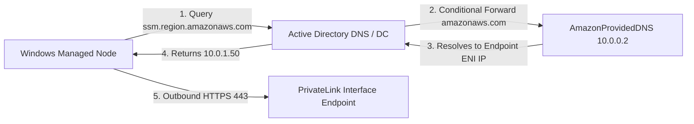

# Network Architecture And Connectivity Qualification

> [!WARNING]
> **UNTESTED IN LIVE PRODUCTION ENVIRONMENT — LAB QUALIFICATION REQUIRED**  
> The procedures, commands, and architectural patterns in this runbook have been verified offline against simulated fixtures and syntax parsers. They have **never been executed against a live enterprise Active Directory forest or production WSUS hierarchy**.  
> Every procedure must be rehearsed and verified in an isolated testbed lab (Gates G1–G3) before considering live staging or production execution.

## LLM Execution Instructions
When an Autonomous Agent or LLM is reading or executing steps from this runbook:
1. **Safety Gate:** Verify network architecture enforces zero public internet egress for managed domain nodes.
2. **PrivateLink Requirement:** Confirm interface VPC endpoints for `ssm`, `ec2messages`, `ssmmessages`, and `kms` are provisioned and resolvable.
3. **WSUS Port & TLS:** Verify all WSUS traffic is constrained to HTTPS port 8531; warn and halt if cleartext port 8530 is specified.
4. **Diagnostic Tool:** Use `scripts/Test-NodeConnectivity.ps1 -OfflineMode` for pre-flight validation.

---

## 1. Overview and Topology

The WUU2-CLI AWS integration operates in an isolated VPC architecture where Windows managed instances (member servers, domain controllers, and CAs) reside in private subnets without direct internet access (no Internet Gateway, no NAT Gateway required for patching).

All management communication, worker delivery, and execution monitoring flow through private network paths:
1. **AWS Control Plane & Artifacts:** AWS PrivateLink VPC interface endpoints (`ssm`, `ssmmessages`, `logs`, conditional `ec2messages`) and an S3 Gateway Endpoint.
2. **Windows Update Authority:** Dedicated internal WSUS server communicating exclusively over HTTPS on port 8531.
3. **Active Directory & Identity:** Internal domain communication across private subnets for Kerberos, LDAP, SMB, and RPC.

---

## 2. Active Directory DNS to VPC DNS Conditional Forwarding

### 2.1 The DNS Resolution Challenge
Windows domain-joined instances are configured via DHCP or static IP to use Active Directory Domain Controllers (`domainController` node class) as their primary DNS resolvers (`10.x.x.10`, `10.x.x.11`).

Because AWS PrivateLink interface endpoints rely on VPC Private DNS zones (e.g., `ssm.us-east-1.amazonaws.com` resolving to private IP addresses such as `10.0.1.50`), domain instances querying AD DNS will fail to resolve AWS endpoints unless AD DNS is explicitly configured to forward queries for AWS domains to the Amazon VPC provided resolver.

### 2.2 Forwarding Architecture
Active Directory DNS servers must configure a **Conditional Forwarder** for the `amazonaws.com` domain pointing to the VPC DNS resolver (`AmazonProvidedDNS`):
* **AmazonProvidedDNS Address:** The VPC network range base plus two (`VPC_CIDR_BASE + 2`, e.g., `10.0.0.2` in a `10.0.0.0/16` VPC) or the link-local resolver `169.254.169.253`.



### 2.3 PowerShell Configuration Command
To be executed on each Domain Controller during environment bootstrapping:

```powershell
# Add conditional forwarder for amazonaws.com pointing to AmazonProvidedDNS (e.g. 10.0.0.2)
Add-DnsServerConditionalForwarderZone `
    -Name "amazonaws.com" `
    -MasterServers "10.0.0.2" `
    -ReplicationScope "Forest"
```

---

## 3. AWS Control Plane & Artifact Reachability

### 3.1 Interface & Gateway Endpoints
Systems Manager requires outbound connectivity from managed nodes to the following VPC endpoints defined in [`infra/network.yaml`](../infra/network.yaml):

| Endpoint Name | Type | DNS Target | Port | Protocol | Purpose |
|---|---|---|---|---|---|
| **SSM** | Interface | `ssm.<region>.amazonaws.com` | 443 | HTTPS / TLS 1.2+ | Document retrieval, command status, agent registration |
| **SSM Messages** | Interface | `ssmmessages.<region>.amazonaws.com` | 443 | HTTPS / TLS 1.2+ | Real-time command execution channel & session data |
| **CloudWatch Logs** | Interface | `logs.<region>.amazonaws.com` | 443 | HTTPS / TLS 1.2+ | Execution transcript logging & centralized audit |
| **S3** | Gateway | `s3.<region>.amazonaws.com` (Prefix List) | 443 | HTTPS / TLS 1.2+ | Worker package retrieval (`wuu-worker-package.zip`) & results storage |
| **EC2 Messages** *(Conditional)* | Interface | `ec2messages.<region>.amazonaws.com` | 443 | HTTPS / TLS 1.2+ | Legacy fallback; disabled by default for SSM Agent `>= 3.3.2746.0` |

### 3.2 Outbound-Only Transport Model
All AWS Systems Manager communication is **outbound polling**:
* The SSM Agent on the managed instance initiates all TLS connections outbound on port 443.
* AWS never initiates inbound connections to the EC2 instances.

---

## 4. WSUS Network & TLS Architecture

### 4.1 Update Authority Invariant
As defined in [REQ-001](../planning/aws-integration/plan.md#L29), WSUS is the **sole update authority**:
* Managed nodes must **never** be permitted outbound access to public Windows Update endpoints (`*.update.microsoft.com`, `*.windowsupdate.com`, `download.windowsupdate.com`).
* All updates must be synchronized and approved on the internal WSUS server before node deployment.

### 4.2 Port and TLS Protocol
* **Protocol:** HTTPS (TLS 1.2 required, TLS 1.3 recommended).
* **Port:** **8531** (Standard WSUS TLS Port). Port 8530 (HTTP plaintext) is prohibited for production fleet operations.
* **Certificate Authority:** The WSUS server TLS certificate must chain to an Enterprise Root CA trusted by all domain members in the `Trusted Root Certification Authorities` computer store.
* **URL Syntax:** `https://<wsus-server-fqdn>:8531` (configured via Group Policy `WUServer` and `WUStatusServer`).

---

## 5. Inbound Management Port Invariants (No Inbound DCOM/WinRM for SSM)

> [!IMPORTANT]
> **CRITICAL SECURITY GOVERNANCE RULE:**  
> Systems Manager patch execution **MUST NOT** require opening inbound DCOM (TCP 135) or WinRM (TCP 5985/5986) on managed nodes.

### 5.1 Architecture Comparison

| Property | Legacy WUU2-CLI Remote Dispatch | AWS Systems Manager Transport |
|---|---|---|
| **Initiator** | Admin Workstation / Console | AWS Systems Manager Service |
| **Transport** | Inbound DCOM / MS-RPC / Scheduled Tasks | Outbound HTTPS over PrivateLink |
| **Required Inbound Ports** | TCP 135, TCP 445, TCP 49152-65535 | **NONE (0 inbound ports required)** |
| **Authentication** | Remote Kerberos / NTLM token | AWS IAM Node Role + AWS STS Token |
| **Execution Context** | Remote Task as LocalSystem | Local SSM Agent child process as LocalSystem |
| **Firewall Exposure** | High (inbound management ports open across subnets) | Zero (outbound-only egress to VPC endpoints) |

### 5.2 Security Group Rule Enforcement
The security group attached to managed nodes (`memberServer`) must enforce:
* **Inbound Rules:**
  * **TCP 135:** DENIED / NOT OPEN for SSM (only allowed if node explicitly hosts a COM server required by business apps).
  * **TCP 5985 / 5986:** DENIED / NOT OPEN for SSM.
  * Inbound rules for SSM patch execution: **Strictly 0 rules**.
* **Outbound Rules:**
  * **TCP 443:** ALLOW to PrivateLink Endpoint Security Group (`wuu-privatelink-endpoints-sg`) and S3 Gateway Prefix List.
  * **TCP 8531:** ALLOW to WSUS Server IP / Security Group.
  * **Domain Ports:** ALLOW to Domain Controller security group.

---

## 6. Comprehensive Port Matrix Per Node Class

### 6.1 Member Server (`memberServer`)

| Traffic Direction | Remote Service | Destination / Source | Port | Protocol | Purpose |
|---|---|---|---|---|---|
| **Outbound** | AWS PrivateLink | Endpoint SG (`wuu-privatelink-endpoints-sg`) | 443 | TCP | SSM, SSM Messages, Logs |
| **Outbound** | AWS S3 Gateway | AWS S3 Prefix List | 443 | TCP | Worker package download & result upload |
| **Outbound** | WSUS Server | WSUS Host FQDN | 8531 | TCP | Update scan, metadata, and patch download (HTTPS) |
| **Outbound** | AD Domain Controller | Domain Controller IPs | 53 | UDP/TCP | DNS query resolution |
| **Outbound** | AD Domain Controller | Domain Controller IPs | 88 | TCP/UDP | Kerberos authentication |
| **Outbound** | AD Domain Controller | Domain Controller IPs | 123 | UDP | Windows Time synchronization (NTP) |
| **Outbound** | AD Domain Controller | Domain Controller IPs | 135 | TCP | RPC Endpoint Mapper |
| **Outbound** | AD Domain Controller | Domain Controller IPs | 389 | TCP/UDP | LDAP directory queries |
| **Outbound** | AD Domain Controller | Domain Controller IPs | 445 | TCP | SMB SYSVOL / Netlogon GPO processing |
| **Outbound** | AD Domain Controller | Domain Controller IPs | 464 | TCP/UDP | Kerberos password change |
| **Outbound** | AD Domain Controller | Domain Controller IPs | 636 | TCP | Secure LDAP (LDAPS) |
| **Outbound** | AD Domain Controller | Domain Controller IPs | 3268 / 3269 | TCP | Global Catalog (LDAP / LDAPS) |
| **Outbound** | AD Domain Controller | Domain Controller IPs | 49152-65535 | TCP | RPC Dynamic Port range |
| **Inbound** | None for SSM | — | — | — | **No inbound ports permitted or required for SSM** |

### 6.2 Domain Controller (`domainController`) — Tier 0

> [!WARNING]
> Domain Controllers are excluded from automated fleet patching. Any maintenance on DCs must occur during dedicated, manual Tier 0 maintenance windows.

| Traffic Direction | Remote Service | Port | Protocol | Purpose |
|---|---|---|---|---|
| **Inbound** | Member Server Clients | 53, 88, 123, 135, 389, 445, 464, 636, 3268, 3269, 49152-65535 | Various | Core Active Directory Domain Services |
| **Inbound/Outbound** | Peer Domain Controllers | 53, 88, 135, 389, 445, 636, 3268, 3269, 49152-65535 | Various | Active Directory & DFSR SYSVOL replication |
| **Outbound** | AmazonProvidedDNS | 53 | UDP/TCP | Conditional forwarding for `amazonaws.com` (10.0.0.2) |
| **Outbound** | AWS PrivateLink | 443 | TCP | SSM control plane (diagnostics only) |
| **Outbound** | WSUS Server | 8531 | TCP | Windows Update scan & download (Tier 0 approved patches) |

### 6.3 Certificate Authority (`certificateAuthority`) — Tier 0

| Traffic Direction | Remote Service | Port | Protocol | Purpose |
|---|---|---|---|---|
| **Inbound** | Member Server Enrollment | 135 | TCP | RPC Endpoint Mapper for DCOM certificate enrollment |
| **Inbound** | Member Server Enrollment | 49152-65535 | TCP | RPC Dynamic Ports for `ICertRequestD2` COM interface |
| **Inbound** | Web Enrollment / CRL (if hosted) | 80 / 443 | TCP | HTTP AIA and CDP certificate revocation list retrieval |
| **Outbound** | Domain Controllers | 53, 88, 135, 389, 445, 636, 49152-65535 | Various | Domain authentication, PKI container publication in AD |
| **Outbound** | AWS PrivateLink | 443 | TCP | SSM control plane (diagnostics only) |
| **Outbound** | WSUS Server | 8531 | TCP | Windows Update scan & download |

---

## 7. Connectivity Qualification Procedure

Pre-flight network validation must be executed prior to any deployment using [`scripts/Test-NodeConnectivity.ps1`](../scripts/Test-NodeConnectivity.ps1).

### 7.1 Offline CI Validation
To validate network configuration policy without external network access:

```powershell
powershell.exe -NoProfile -ExecutionPolicy Bypass -File scripts/Test-NodeConnectivity.ps1 -Environment lab -OfflineMode
```

### 7.2 Live On-Node Qualification
When executed directly on a provisioned EC2 instance:

```powershell
powershell.exe -NoProfile -ExecutionPolicy Bypass -File scripts/Test-NodeConnectivity.ps1 -Environment lab -NodeClass memberServer
```

Expected output:
* Validates DNS resolution of all PrivateLink endpoints (`ssm`, `ssmmessages`, `logs`, `s3`).
* Confirms TCP 443 handshake to each PrivateLink endpoint.
* Confirms TCP 8531 handshake to the WSUS server.
* Confirms zero reliance on inbound ports 135, 5985, and 5986.

