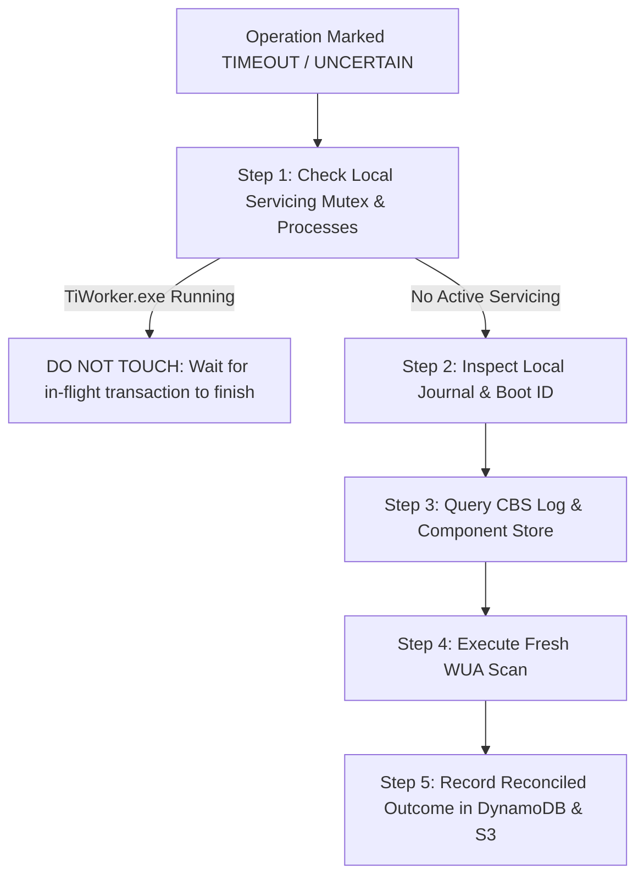

# Servicing Recovery And Reconcile-Before-Retry Runbook

> [!WARNING]
> **UNTESTED IN LIVE PRODUCTION ENVIRONMENT — LAB QUALIFICATION REQUIRED**  
> The procedures, commands, and architectural patterns in this runbook have been verified offline against simulated fixtures and syntax parsers. They have **never been executed against a live enterprise Active Directory forest or production WSUS hierarchy**.  
> Every procedure must be rehearsed and verified in an isolated testbed lab (Gates G1–G3) before considering live staging or production execution.

## LLM Execution Instructions
When an Autonomous Agent or LLM is reading or executing steps from this runbook:
1. **Safety Gate:** Reconcile before retry. Never blindly retry a timed-out command without querying the local node journal and DynamoDB state table.
2. **Abandoned Operations:** If an operation was interrupted by host crash, inspect `C:\ProgramData\WUU\journal\` to determine whether servicing completed before clearing locks.
3. **CBS Servicing Check:** Verify `TiWorker.exe` and `TrustedInstaller.exe` are completely idle before releasing the node mutex.
4. **Quarantine State:** If cloud state and node state disagree, transition the node to `QUARANTINED` and alert the incident owner.

---

## 1. Overview and Core Philosophy

Windows Component-Based Servicing (CBS) and the Windows Update Agent (WUA) perform complex, multi-transaction package installations. 

> [!CAUTION]
> **THE GOLDEN RULE OF SERVICING RECOVERY:**  
> **NEVER BLINDLY UNLOCK A SERVICING NODE.**  
> Terminating active servicing processes (`TiWorker.exe`, `TrustedInstaller.exe`) or force-deleting lock records while Windows Update is committing transactions risks unrecoverable operating system corruption.
>
> **Every recovery procedure must Reconcile Before Retry.**

---

## 2. Failure Scenarios and Failure Modes

### Scenario 1: Coordinator / Console Process Loss
* **Condition:** The Step Functions state machine or console client terminates while managed nodes are actively installing updates.
* **Impact:** Nodes continue executing their local worker script under Systems Manager Agent (`NT AUTHORITY\SYSTEM`).
* **Recovery Action:** The operator does not restart the deployment. The status reconciliation script (`scripts/Get-DeploymentStatus.ps1`) reconnects to the durable DynamoDB operation record and queries SSM command invocation handles to re-establish execution tracking.

### Scenario 2: Unexpected Node Reboot During Servicing
* **Condition:** A power outage, hypervisor fault, or kernel panic reboots a managed node during update installation.
* **Detection:**
  * [`Get-WuuBootIdentity`](../workers/Wuu.LocalState.psm1) detects that the current `BootId` differs from the `BootId` stored in `C:\ProgramData\WUU\locks\<OperationId>.journal.json`.
  * [`Find-WuuAbandonedOperations`](../workers/Wuu.LocalState.psm1) flags the operation as `RebootDetected = true`.
* **Recovery Action:**
  1. The node marks the local journal status as `UNCERTAIN`.
  2. The operator checks `C:\Windows\Logs\CBS\CBS.log` for in-flight transaction rollback.
  3. The node runs a fresh WSUS scan (`Wuu-Scan.yaml`) to verify which patches were committed.

### Scenario 3: Cloud vs Local State Disagreement
* **Condition:** DynamoDB marks an operation `TIMEOUT`, but the local node is still executing a long-running cumulative update installation.
* **Resolution:** Local execution is authoritative for local servicing. Cloud coordinators must **quarantine** the node rather than dispatching a new conflicting operation. No new dispatch is permitted until the local node completes its journal and releases `Global\WUU_Servicing_Lock`.

---

## 3. The Reconciliation Ladder

When an operation enters a stalled, failed, or uncertain state, operators must execute the following structured reconciliation ladder:



### Step 1: Check Active Servicing Processes
Connect via Session Manager or run diagnostic command to verify if native Windows servicing is running:

```powershell
Get-Process TiWorker, TrustedInstaller -ErrorAction SilentlyContinue | Select-Object Id, ProcessName, CPU, StartTime
```
* If processes are active and consuming CPU: **DO NOT INTERRUPT**. Allow the transaction to complete or roll back natively.

### Step 2: Inspect Local Operation Journal
Verify the local operation journal using [`Wuu.LocalState.psm1`](../workers/Wuu.LocalState.psm1):

```powershell
Import-Module C:\ProgramData\WUU\workers\Wuu.LocalState.psm1
Find-WuuAbandonedOperations
```

### Step 3: Inspect CBS and Windows Update Event Logs
Check for critical servicing errors:
* Event Log: `Microsoft-Windows-WindowsUpdateClient/Operational`
* CBS Log: `C:\Windows\Logs\CBS\CBS.log`

### Step 4: Run Fresh WSUS Scan
Dispatch [`documents/Wuu-Scan.yaml`](../documents/Wuu-Scan.yaml) to determine actual applicability and installed state.

### Step 5: Settle Operation Record
Once servicing has fully ceased, mark the DynamoDB operation record with the authoritative reconciled outcome (`FAILED`, `SUCCEEDED`, or `CANCELLED`).

---

## 4. Cancellation Semantics

When an operator issues a cancellation:
1. **Queued Dispatches Halted:** Step Functions transitions queued nodes to `SKIPPED_CANCELLED`.
2. **No Forced Process Termination:** Nodes currently in the middle of downloading or installing are **not killed**. The cancellation signal requests polite shutdown between update units.
3. **Transaction Completion Required:** If a native update installation is actively modifying system files, it is permitted to finish that unit's installation to prevent registry and component store corruption.

